# Omega Protocol — Practice Lab

《FFXIV The Omega Protocol (Ultimate)／絕歐米茄》的 Godot **4.7.2-stable** 單人機制練習工具，fork 自 [WCGH/Dragonsong-Sim](https://github.com/WCGH/Dragonsong-Sim)。

**[v0.3.34 Web／精確來源下載](https://github.com/aki-terminal-leaf/Omega-Protocol-Sim/releases/tag/top-v0.3.34-preview)** · [v0.3.34 Windows離線](https://github.com/aki-terminal-leaf/Omega-Protocol-Sim/releases/tag/top-v0.3.34-preview) · [逐機制 Buff／Debuff](docs/research/MECHANIC_STATUSES.md) · [攻略來源](docs/research/STRATEGIES.md)

### v0.3.34 已更新 Web：原始武器動作與模型呈現

加入原始武器動作與模型呈現，保留現有練習特效；未驗收的原始粒子不在發佈版啟用。本段不是全階段特效還原，女性完整起手、光之眼開合及原版場景材質仍待完成。[本段範圍與驗證](docs/development/WEB_V0334.md) · [分支與逐段發佈規則](docs/development/BRANCHES.md)。已發佈並更新 [固定網頁版](https://top.servicing.cc)，執行碼 `e325886`。來源／原生限定檢查、46 項精確 PCK 檢查、實際 Chrome／RX 7900 XT 的動作、暫停、R 重練、D 移動／放鍵，以及 13 項 HTTPS 內容校驗與全新公開啟動通過。

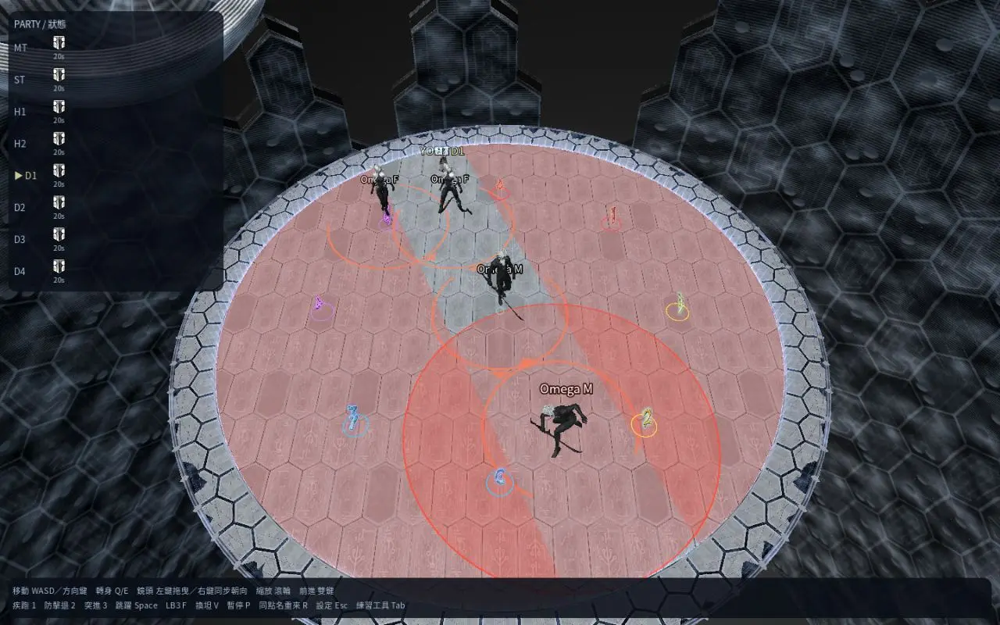

**Windows x64 離線版也已增補至同一 release。** 解壓縮後執行 EXE 並保留相鄰同名 PCK；練習本體無需網路。正式包完成 HW／協同程序／地火三段示範及原生視窗 P、R、D 移動／放鍵驗證；完整攻略與完整原始特效仍未完成。[Windows 限定驗證](docs/development/WINDOWS_V0334.md)。

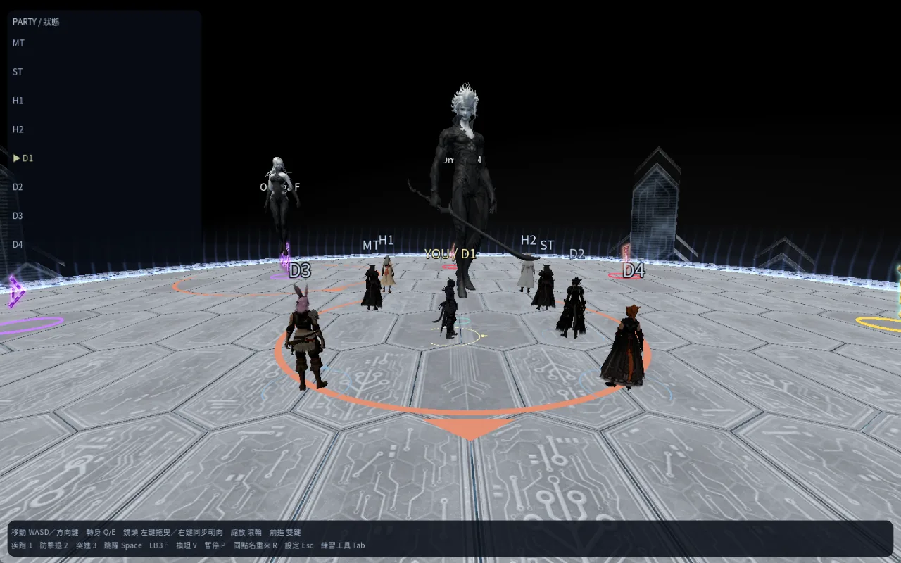

目前 TOP 全部未完成路線圖已恢復開發；AnAn 桌面使用期限為 2026-10-28 18:00 台灣時間。以下舊版段落中的桌面停用是當時狀態，不代表本次授權。

### v0.3.32 已部署基線（歷史）：HW 非中心合法選塔／NPC 實際塔範圍

前一基線曾在 [top.servicing.cc](https://top.servicing.cc) 部署 v0.3.32（執行碼 `804b6ea`）。HW 後續輪次的 NPC 選塔成員依真正揭露的塔範圍與玩家實際位置判斷，不再要求玩家貼齊塔中心；合法非中心選擇不因偏離攻略座標單獨失敗。玩家仍以實際攻擊、Buff／Debuff及死亡結果判定。[修正與界線](docs/development/HW_LATER_CHOICE.md) · [本版驗證](docs/development/WEB_V0332.md) · [Web／精確來源／校驗下載](https://github.com/aki-terminal-leaf/Omega-Protocol-Sim/releases/tag/top-v0.3.32-preview)。

同一新 PCK 23組通過，含5,570幾何檢查、六個合成後續輪次／64項（3正向PASS、3預期負向FAIL，保留真實失敗）；這些案例使用合成NPC前段，不是普通手動Web通關。另一次全新普通Web首輪7項／39份報告、5次新畫面互動確認與8張當次畫面核對通過；正式HTTPS13種表示與獨立全新啟動通過。

**操作展示**：P3「你好，世界」→ Elemental → 自行WASD，放開後不由NPC救位，R同點名重練清空未來資訊。下圖依序播放同一次實際擷取的「塔提示前／實際塔出現／R後」三張畫面，不是連續錄影，也不是後續輪次手動通關。

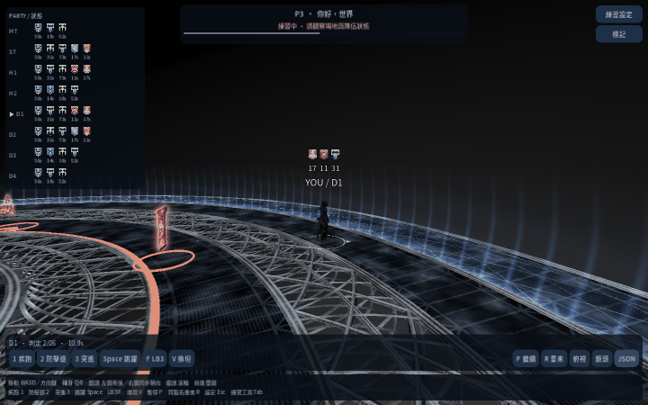

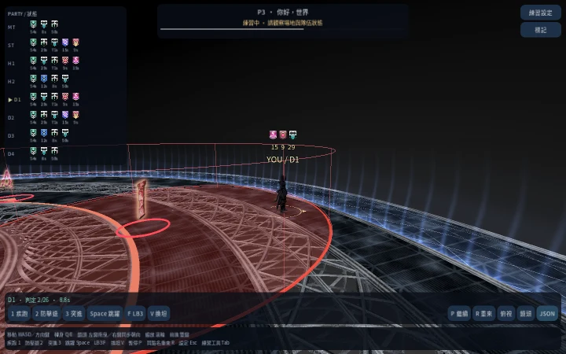

瀏覽器只驗首輪公開來源、D鍵移動、放鍵不救位及R重練，止於塔／大圈判定前；沒有後續輪次普通手動／公開憑據、全攻略、原生、實體GPU或FPS驗收。原生32待驗，AnAn桌面仍停用；全20／102攻略正確性→量測效能→完整AVFX繼續。

### v0.3.31 已部署基線（歷史）：P2 莫古力同頭標 NPC 左右優先序

前一基線曾在 [top.servicing.cc](https://top.servicing.cc) 部署 v0.3.31（執行碼 `7116ade`）。同頭標依 H1 > MT > ST > D1 > D2 > D3 > D4 > H2 順序，高順位站在面向光之眼的左側；回報案例 D2 左、D4 右已修正。其他四方法、原始頭標／亂數／攻擊／狀態規則不變；玩家仍依實際受擊、Buff／Debuff與死亡判定，不要求精確攻略座標。[修正與範圍](docs/research/P2_CN_PRIORITY_FIX.md) · [本版驗證](docs/development/WEB_V0331.md) · [Web／精確來源／校驗](https://github.com/aki-terminal-leaf/Omega-Protocol-Sim/releases/tag/top-v0.3.31-preview)。

同一新 PCK 21組與單次完整實際 Web 20項／118份報告通過，含8次全新畫面互動確認、18張當次畫面核對；固定 HTTPS 13種表示與獨立全新啟動通過。來源包含1,024順位檢查、640生成差分、64初始排列與2個完整NPC示範／38檢查，來源示範與Web範圍分開計算。

**操作展示**：選 P2「協同程序」→「莫古力」→ 開始練習；七名NPC先排固定橫列，玩家自行WASD加入，放開後保持位置，按R同點名回到中立出生點。下圖依序播放同次實際擷取的「未操作／加入／R後」三張畫面，不是連續錄影，也不是完整機制通關。

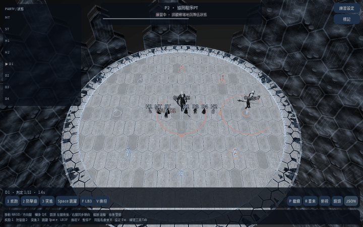

另以公開設定固定seed2／6並明確啟用NPC示範：兩次先逐人核對實際HUD頭標，再檢查四組同圖案左右順位及D2左／D4右。這兩段均停在Fire判定前，沒有玩家通關或攻擊結果驗收；光之眼座標軸來自來源參考，不冒稱公開報告量測值。

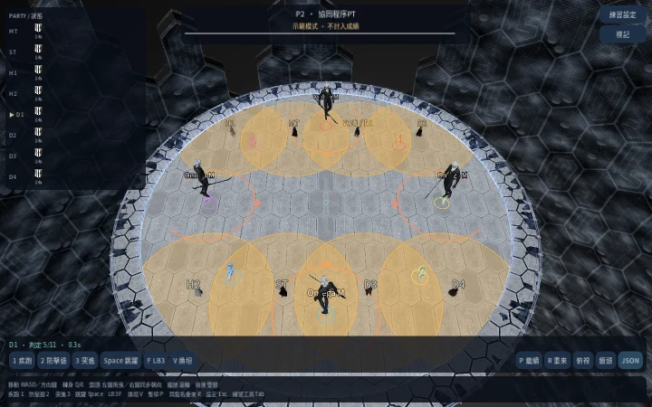

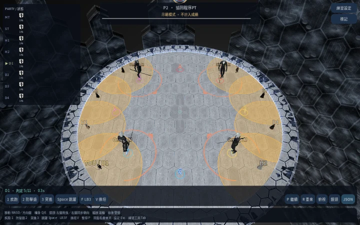

本版未完成CN公開頭標憑據工作流、全部攻略／玩家分支、原生或實體GPU／FPS驗收；舊失敗原樣保留、不改判通過。原生31待驗、AnAn桌面停用；全20／102攻略正確性→量測效能→完整AVFX繼續。

### v0.3.30 已部署基線（歷史）：Hello World 後續輪次可返回選塔

前一基線曾在 [top.servicing.cc](https://top.servicing.cc) 部署 v0.3.30（執行碼 `484ebfd`）。修正判塔前玩家從另一塔返回時，NPC 還保留舊選擇的問題；判定後本輪責任凍結。玩家仍依實際攻擊／狀態／死亡判定，不要求精確攻略座標。[修正與範圍](docs/development/HW_LATER_CHOICE.md) · [本版驗證](docs/development/WEB_V0330.md) · [Web／來源／校驗](https://github.com/aki-terminal-leaf/Omega-Protocol-Sim/releases/tag/top-v0.3.30-preview)。

同一新 PCK 十八組通過，含108生命週期與三個後續輪次 Main 流程／48項：兩個正向通過、太晚返回保留真正失敗。全新 Web 七項／78報告檢查首輪提示前後、WASD、放開後不被救位、R清空；八張當次畫面另行核對。固定 HTTPS 十三種表示與獨立全新啟動通過。

**操作展示**：選 P3「你好，世界」→ Elemental → 自行 WASD；實際塔出現前後對照，再以 R 同點名重練。下圖依序播放三張同次實際擷取畫面（提示前／真塔出現／R後），不是連續錄影，也不是後續輪次手動通關。

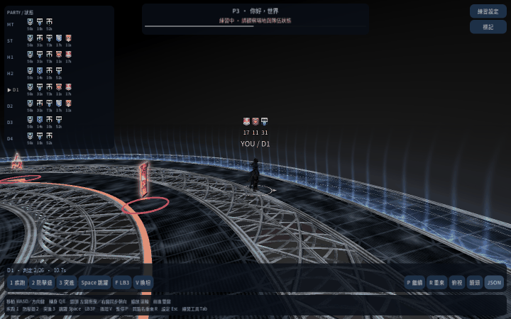

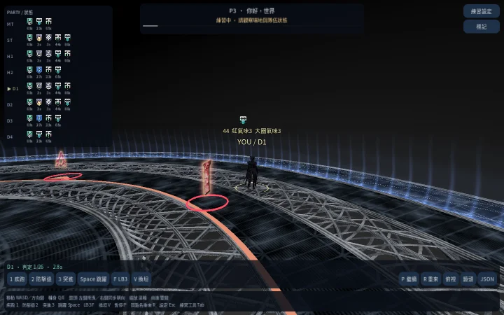

這是限定 Elemental 中心案例與合成全NPC前段後接實體WASD；不涵蓋所有合法非中心站位、全攻略／角色或後續輪次普通手動Web。沿用五個同版本靜態UI定位，沒有新的逐步互動確認；舊失敗不改判通過。原生30待驗，AnAn桌面停用；全20／102正確性、量測效能與完整AVFX繼續。另行推送的P2莫古力D2／D4排序修正不在此包。

### v0.3.29 已部署基線（歷史）：09STOP 固定無點名 DPS／D3 外移

前一基線曾在 [top.servicing.cc](https://top.servicing.cc) 部署 v0.3.29（執行碼 `132e3ba`）。新增獨立「固定無點名DPS」與「D3外移」選項，NPC依當前公開檢知／Boss方向分配，玩家自行走位與轉向；舊六打法不變。合法異位仍按實際攻擊／狀態／死亡判定，不因偏離攻略座標單獨失敗。[來源與推導界線](docs/development/P3_MONITOR_FIXED_DPS.md) · [Web／精確來源／校驗](https://github.com/aki-terminal-leaf/Omega-Protocol-Sim/releases/tag/top-v0.3.29-preview)。

新PCK十三組與單次完整實際Web八項通過：公開選單分別選兩政策，seed5確認D3內／外與ST補位交換，seed17由有檢知的D3自行WASD及右鍵轉向；三次正向均核對四組實際攻擊配對、八人各一次受擊、5秒／7秒狀態、無死亡或異常。R保留seed17並清空舊結果；不操作的D3發生真正重複受擊而FAIL，不由NPC救場。每次開始前從當前設定畫面確認固定種子與0.5×；最終畫面另行檢查。固定HTTPS十三種表示與全新啟動通過。

來源1,792組／32,726項、56實際Main／995項、20舊Main／372項、72NPC／258項及384舊生成／RNG／排序保持通過。原圖未校準精確公尺，東側鏡像與完整H/T補位是推導；這是限定腳本Web，不是原生、真人通關、FPS或全20／102攻略驗收。原生29待驗、AnAn桌面停用；其餘攻略、量測最佳化與完整AVFX繼續。

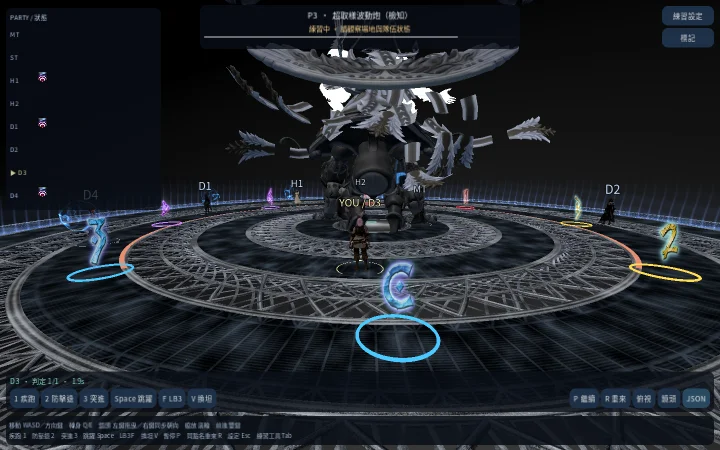

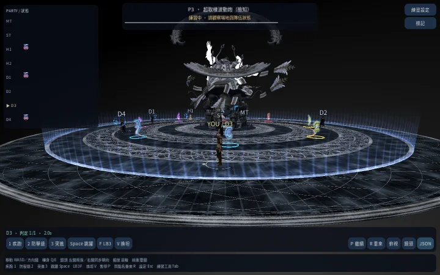

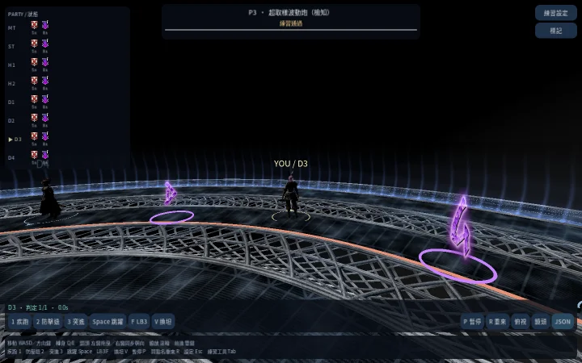

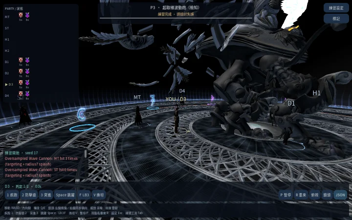

### v0.3.28 已部署基線（歷史）：LPDU N4 避開光束邊界

前一基線曾在 [top.servicing.cc](https://top.servicing.cc) 部署 v0.3.28（執行碼 `d8f37ce`）。只調整LPDU第四名無檢知NPC的訓練位置，維持N4靠內／N5靠牆，避開M1光束邊界；玩家仍以實際攻擊／狀態／死亡判定，合法非攻略座標不會單獨判失敗。

來源四案例87項、32種子純規則3873項、72NPC案例258項、六種檢知20條Main輸入372項通過；4800完整生成差分僅48組LPDU的N4位置改變。相同新PCK十一組、完整單次實際Web八項、固定HTTPS十三種表示與全新啟動均通過（啟動檢查不是第二次遊戲流程）。Web用公開選單、WASD／暫停中右鍵轉向／P／R／報告，開始前確認固定seed1、0.5×；實測轉向約0.229度，八人各受擊一次、原始配對及5秒／7秒狀態正確，R清空，不操作的D3漏吃攻擊並缺少應有狀態而真實FAIL。最終畫面另行檢查；前兩次腳本假設失敗原樣保留，不拼接為通過。[來源與範圍](docs/development/P3_LPDU_N4.md) · [Web／來源／校驗](https://github.com/aki-terminal-leaf/Omega-Protocol-Sim/releases/tag/top-v0.3.28-preview)。

工程間距與微轉角不是官方公尺／容差認證，也不是來源精確0.1度測試的同一操作；舊理想快照測試719失敗原版同樣重現，保留失敗、不列為通過。限定腳本Web，不是原生、真人全流程、FPS或全20／100攻略驗收。原生28待驗、AnAn桌面停用；其餘攻略、量測最佳化與完整AVFX繼續。

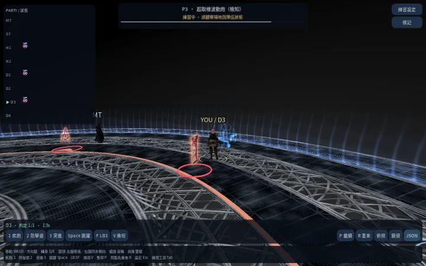

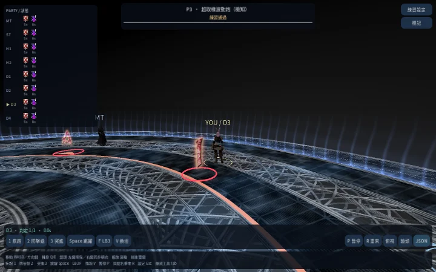

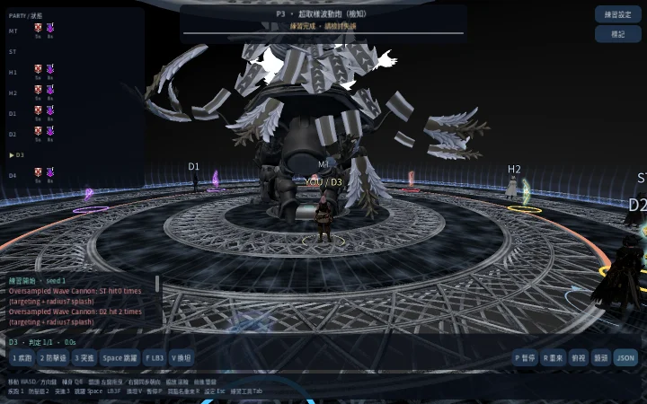

### v0.3.27 已部署基線（歷史）：Astoh M2玩家／N3 應變

前一基線曾在 [top.servicing.cc](https://top.servicing.cc) 部署 v0.3.27（執行碼 `485bd84`）。僅 Astoh、玩家為 M2 時，N3 依當前公開提示與玩家實際穩定位置／面向調整目標；其他六名 NPC、玩家輸入與實際攻擊／狀態／死亡判定不變。合法異位不會僅因沒踩攻略座標而失敗，晚到的錯面向不保證被救回。

來源19條實際流程641項、20條回歸372項、純39項與必要既有檢查通過；同一新PCK21組、實際Web八項、固定HTTPS十三種內容與全新啟動均已驗證。Web用公開選單、WASD／暫停中右鍵朝向／P／R及報告；開始前確認固定seed1、0.5×。實際觀察到N3非標準目標、到達與凍結、攻擊通過／八人狀態時長、R清空，以及不動的實際攻擊失敗。另行檢查最終畫面；前四輪失敗保留，不改判通過。[來源與界線](docs/development/P3_MONITOR_ADAPTIVE.md) · [Web／精確來源／校驗](https://github.com/aki-terminal-leaf/Omega-Protocol-Sim/releases/tag/top-v0.3.27-preview)。

只是限定腳本Web驗證，不是原生、真人全流程、FPS或全20／100攻略認證；網格／13度工程輸入不是官方容差。原生27待驗、AnAn桌面停用；量測最佳化與完整AVFX繼續。

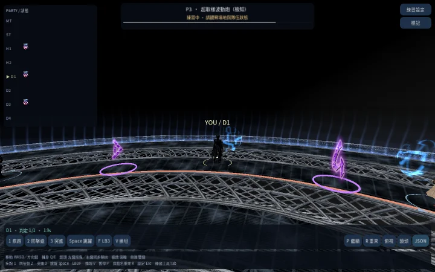

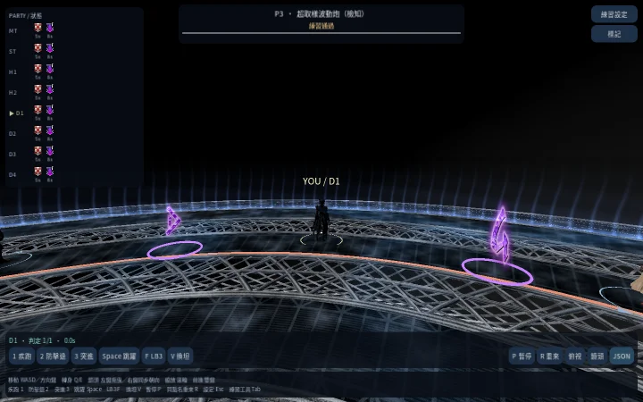

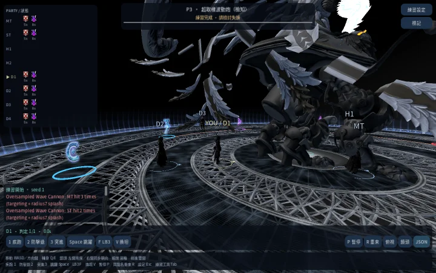

### v0.3.26 已部署基線（歷史）：玩家結果判定＋莫古力開場固定橫排

前一基線曾在 [top.servicing.cc](https://top.servicing.cc) 部署 v0.3.26（執行碼 40de224）。

**新玩家判定政策**：玩家PASS／FAIL依模擬中實際攻擊命中、狀態與死亡結果判定，不再要求站到攻略座標；走非攻略但實際安全的位置也算通過。未量測的P6傷害獨立標為 UNKNOWN 驗證項，不推定死亡、也不代表真實遊戲可存活。NPC是否遵照攻略另為一軸。

**CN開場NPC橫排**：七名NPC按 H1 MT ST D1 D2 D3 D4 H2 朝 A 橫排；玩家可從中立出生點自己用 WASD 加入，不被補位；未排隊不會攔住頭標時間軸，也不單因此判失敗。實際Web只驗到3秒頭標前。

來源驗證：結果判定純25項、實際Main 4流程19項、規則196、P6精度55、P6 LB 604、全域20課程；同一PCK 16組檢查、分組取證的八項公開Web練習操作（0.5×只在CN開始前確認）、固定HTTPS十三種表示與全新啟動通過。[玩家結果判定](docs/development/PLAYER_OUTCOME_VERDICT.md) · [CN開場範圍](docs/development/P2_CN_INITIAL_LINEUP.md) · [Web／精確來源／校驗](https://github.com/aki-terminal-leaf/Omega-Protocol-Sim/releases/tag/top-v0.3.26-preview)。

八項採CN／安全異位與Solar受擊／R分項組合驗證，不代表先前失敗的整體流程已改判通過。不是全P2、全20／100攻略、原生、手動、實體GPU或FPS認證。同圖案左右來源未知、CN公開圖形分組、已知後續Fire私有目標依賴、新北仍OPEN。原生26待驗（AnAn桌面停用）；Windows20獨立。

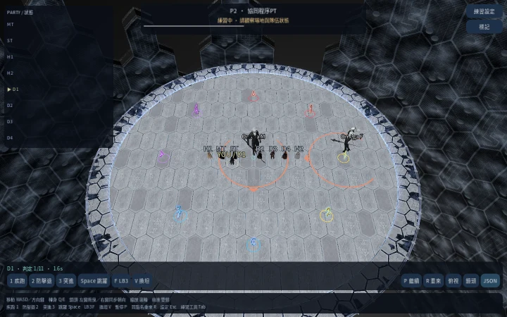

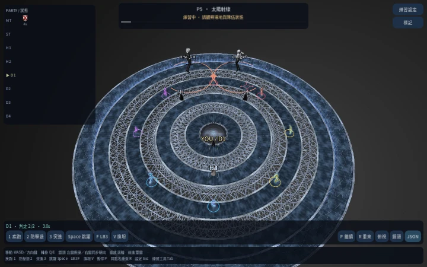

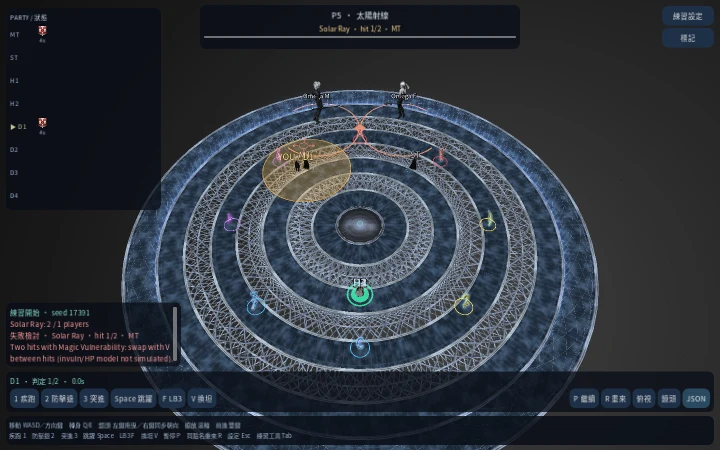

### v0.3.25 已部署基線（歷史）：從真正可見分身辨認新北

前一基線曾在 [top.servicing.cc](https://top.servicing.cc) 部署 v0.3.25（執行碼 c0d79cb）。Elemental／Aether／LPDU 的 NPC 在身體實際顯示後，才依五個外圈男分身的公開幾何辨認新北；缺少來源時等候，真正消失可記住過去，完整矛盾則撤銷。保留擊退前置集合，玩家仍須自己操作，不由 NPC 救場。

來源純1,345項、原版模型20條Main／274項（13正向、7控制）、三攻略生命週期84項、240完整生成差分與12組既有回歸通過；同一新PCK的17組檢查及實際Web9項操作、固定HTTPS13種表示與全新啟動通過。[來源與限定範圍](docs/development/P2_PUBLIC_NORTH.md) · [Web／來源／校驗](https://github.com/aki-terminal-leaf/Omega-Protocol-Sim/releases/tag/top-v0.3.25-preview)。

Web 操作透過公開「分段輔助」重建**較早的圖形記憶**，新北仍須來自**當前真正顯示的分身**；驗證在27.1秒擊退前停止，不是普通全課程或瀏覽器後段戰鬥通關。負向提示及真實擊退／分攤／刀判定屬同PCK Main證據。CN／KR新北、LPDU武器側軸、原遊戲精確五點位置及全部攻略仍未結清；原生25待驗，Windows20保留獨立證據。全20／100正確性、量測最佳化與完整AVFX繼續。

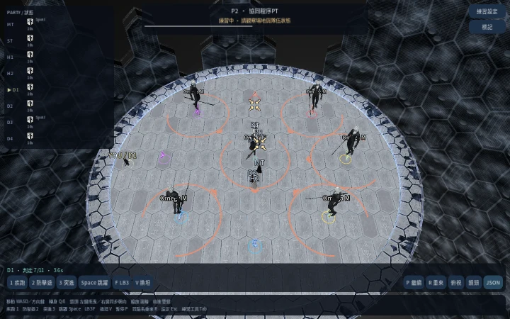

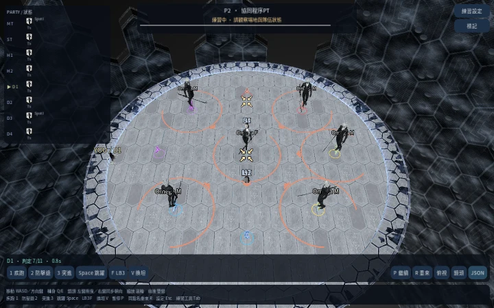

### v0.3.24 已部署基線（歷史）：NPC 依實際武器提示躲避

前一基線曾在 [top.servicing.cc](https://top.servicing.cc) 部署 v0.3.24（執行碼 47dec6d）。Elemental／Aether／LPDU／CN／KR 的武器躲避不再讀已解答位置，而是辨認真正可見的外側分身與實體武器。缺少提示時停在當前位置；先前看到的提示消失可記住，雙武器等矛盾提示則撤銷記憶。玩家仍自己操作，錯誤提示不會被隱藏答案救回。

純197項、十五原版模型Main課程／187項、五選項240組完整生成差分與必要回歸通過。相同新PCK十五組檢查；實際Web八項涵蓋提示前後、實體武器觀察、七NPC公開路徑、玩家輸入／釋放與R清空，固定HTTPS十三種表示及全新啟動通過。[來源與限定範圍](docs/development/P2_PUBLIC_WEAPONS.md) · [Web／來源／校驗](https://github.com/aki-terminal-leaf/Omega-Protocol-Sim/releases/tag/top-v0.3.24-preview)。

瀏覽器驗證止於13.4秒傷害判定前；錯誤／缺失／矛盾武器與實際傷害證據來自同一PCK的十五Main課程，不冒稱瀏覽器注入或手動通關。單一格點路徑仍是限定範圍；LPDU分組側、新北、後段、完整P2／全攻略、量測最佳化與完整AVFX繼續。原生24待驗，Windows20保留獨立證據。

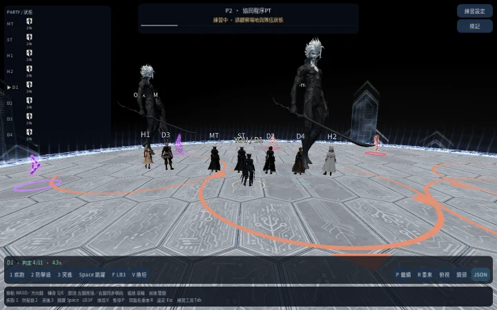

### v0.3.23 已部署基線（歷史）：Aether 實際橫排換序與公開圖形記憶

前一基線曾在 [top.servicing.cc](https://top.servicing.cc) 部署 v0.3.23（執行碼 7a98670）。HRMTTMRH 只是推薦起始橫排；玩家可自己換序，七名 NPC 依玩家實際位置留位。真正顯示八人圖形後，按同圖案實際左右記住同畫面位置；之後移動不改寫過去，不讀未揭露真配對、不替玩家操作或救場。Remote 僅外側列互換，保留 LPDU／Elemental 各自規則。

純2,520種／30,351項、單元64項、Main159項、141條實際輸入課程／1,825項、240生成差分及必要回歸通過。相同新PCK十三組檢查；實際Web十項操作包含跨過同圖案搭檔／NPC留位、八人圖形與同畫面位置記憶、擷取後再移動／放開按鍵／R清空，固定HTTPS十三種表示與全新啟動皆通過。[來源與限定範圍](docs/development/P2_AETHER_PREPARATION.md) · [Web／來源／校驗](https://github.com/aki-terminal-leaf/Omega-Protocol-Sim/releases/tag/top-v0.3.23-preview)。

僅結清這批初始橫排與公開記憶互動；首次完整圖形觀察凍結是訓練政策，不是已證實遊戲鎖定時限。武器／新北／後段分攤、全部P2／攻略、量測最佳化與完整AVFX仍繼續。無桌面SwiftShader不是原生／實體GPU或真人完整通關；v0.3.23原生待驗，Windows v0.3.20保留自身獨立證據。

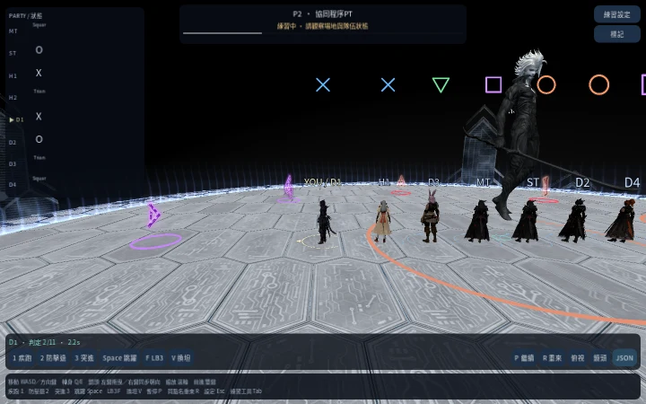

### v0.3.22 已部署基線（歷史）：LPDU 初始 THMR 與公開圖形分組

前一基線曾在 [top.servicing.cc](https://top.servicing.cc) 部署 v0.3.22（執行碼 e29b514）。LPDU 頭標前依 T/H/M/R 雙列；實際看見八人圖形後，同側同圖案僅南邊的人換側。Remote 右側為 BPOG/GOPB 完全反轉，不混用 Elemental／Aether。玩家自己操作，NPC 記住已見圖形、不替玩家移動或救場；真搭檔、點名、移速與判定不變。

LPDU2,520種／45,448項、Main306項、29條WASD／345項及Elemental／P2／240生成差分／20機制必要回歸通過。同一新PCK十一組檢查、實際Web的THMR初始隊列／八人頭標前後／輸入釋放／R重練、固定HTTPS十三種內容與全新啟動通過。[來源與限定範圍](docs/development/P2_LPDU_PREPARATION.md) · [Web／來源／校驗](https://github.com/aki-terminal-leaf/Omega-Protocol-Sim/releases/tag/top-v0.3.22-preview)。

僅結清 LPDU 初始準備與一致的圖形記憶路由。後段分攤原始列隊歧義、武器／新北、Aether自由換序、全部P2／攻略、最佳化與完整AVFX仍繼續；無桌面SwiftShader不是原生／實體GPU或真人完整通關。v0.3.22原生待驗，Windows v0.3.20保留自身限定證據。

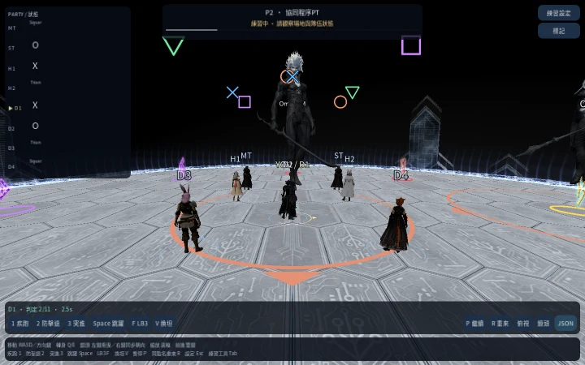

### v0.3.21 已部署基線（歷史）：P2 Elemental 職能列隊與指定換邊

前一基線曾在 [top.servicing.cc](https://top.servicing.cc) 部署 v0.3.21（執行碼 50ae0d8）。頭標出現前保持 H/T/M/R 初始列隊；看見八人實際圖形後，同側重複僅下位者換邊，原點名與真搭檔不變。玩家自己操作；NPC 記住已見圖形，不替玩家移動或救場。

2,520 種純分組／85,814項、240組生成保留差分、Main350項、29條實際WASD／345項及必要回歸通過；同一新PCK八組檢查、實際Web頭標前後／輸入釋放／R重開、固定HTTPS十三種內容與全新啟動通過。[來源與限定範圍](docs/development/P2_ELEMENTAL_PREPARATION.md) · [發布／校驗](https://github.com/aki-terminal-leaf/Omega-Protocol-Sim/releases/tag/top-v0.3.21-preview).

只結清 Elemental 初始準備；其他四打法、武器／新北、完整P2、全攻略、最佳化與完整AVFX繼續。無桌面 SwiftShader WebGL2 不是原生／實體GPU或真人通關；v0.3.21 原生仍待驗，既有 v0.3.20 Windows包保留其自身限定驗證。

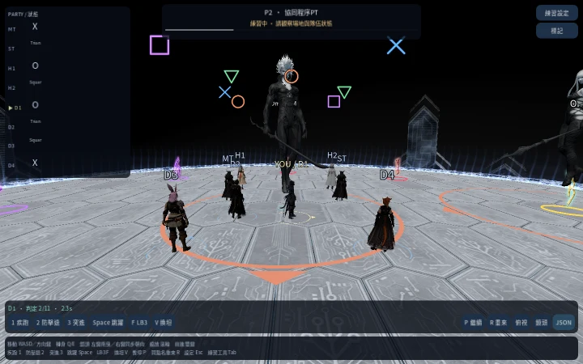

### v0.3.20 已部署基線（歷史）：HW 首輪 NPC 預處理與玩家配合

前一基線曾在 [top.servicing.cc](https://top.servicing.cc) 部署 v0.3.20（執行碼 d8bd203）。首輪塔尚未顯示前不依塔方向出生／預站；實際塔出現後才選外圈路徑。NPC 依玩家真正靠近或站定的同色側配合，結算前可回應玩家回側；玩家仍須自己操作，合法原地不強迫移動，漏做／錯做不會被救回。原移速、塔／感染／Bug／Debugger與傷害判定不變，分段重建清楚標為輔助。

來源42項、Main367（含80組初始資訊差分及五打法四輪）、67條操作／621項、100條NPC四輪／600項與必要回歸通過；新PCK十項受影響檢查、實際Web操作／塔揭示／重試、固定HTTPS與全新啟動通過。詳見 [HW首輪範圍](docs/development/HW_PUBLIC_FIRSTWAVE.md)及 [發布／來源／校驗](https://github.com/aki-terminal-leaf/Omega-Protocol-Sim/releases/tag/top-v0.3.20-preview)。

這只結清首輪限定修正，不是全部攻略或真人完整通關認證。後續輪次資訊隔離、初始八方玩家預處理、其他玩家分支、最佳化與完整AVFX繼續。Windows x64離線包已在 [同一發布頁](https://github.com/aki-terminal-leaf/Omega-Protocol-Sim/releases/tag/top-v0.3.20-preview)追加。AnAn正式執行檔130秒HW示範，以及實際視窗D輸入／釋放／塔提示／R重練通過；這是限定腳本原生操作，不是玩家真人完整通關。完整解壓縮後執行EXE並保留相鄰PCK；Web與Windows使用相同已驗PCK。


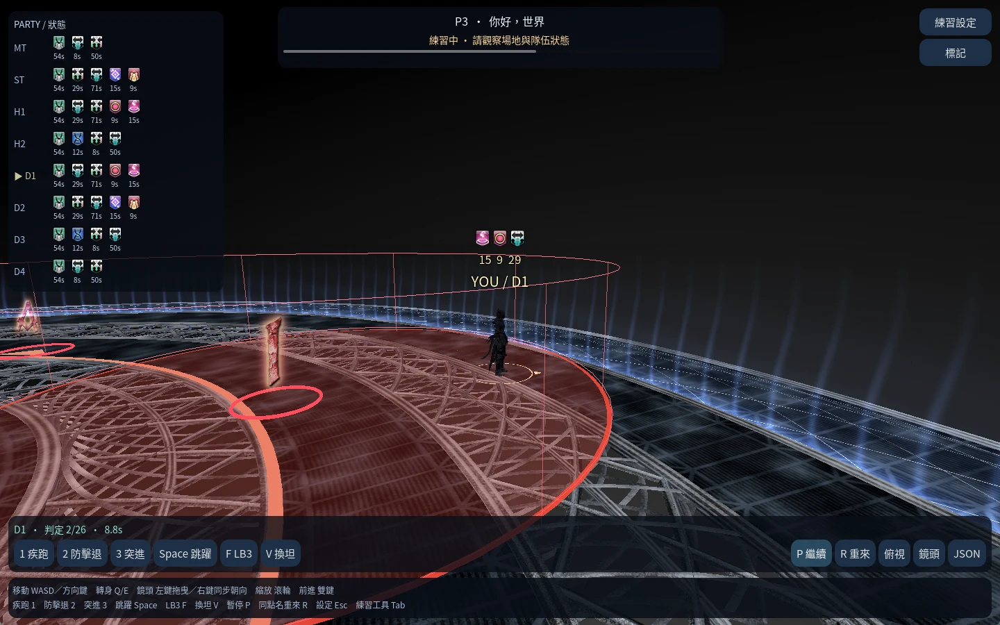

### v0.3.19 已部署基線（歷史）：P3 提示狀態與異常回饋

前一個基線曾在 [top.servicing.cc](https://top.servicing.cc) 部署 v0.3.19（執行碼 5d790cd）。正常練習維持簡潔；Tab 可看不透露方向的提示狀態。提示資訊無法確認時，沿用既有介面提供 R 同點名重練選項；不改判定、分數、暫停或玩家走位。

來源 848 項純檢查、210 項 Main（82 幀正常流程零誤警示）及必要既有回歸通過；新 PCK 七項受影響檢查、實際 Web 的六欄位狀態／提示前後／移動與釋放／重試、固定 HTTPS 資源與全新啟動通過。未改動的舊機制保留 v0.3.18 基線，不宣稱重跑所有舊矩陣。詳見 [診斷範圍](docs/development/P3_OBSERVATION_DIAGNOSTICS.md)及 [Web／來源發布](https://github.com/aki-terminal-leaf/Omega-Protocol-Sim/releases/tag/top-v0.3.19-preview)。

原生仍待驗；使用者已重新開放 AnAn 桌面驗證。無桌面 SwiftShader WebGL2 不是實體 GPU 或真人完整通關。全部攻略、最佳化與完整 AVFX 工作繼續保留。

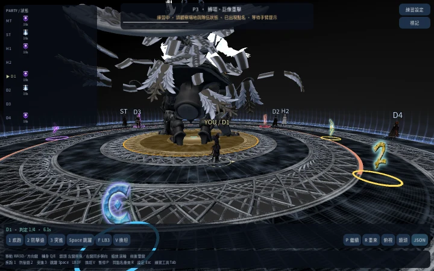

### v0.3.18 已部署基線（歷史）：P3 公開資訊走位與玩家操作驗證

上一個基線曾在 [top.servicing.cc](https://top.servicing.cc) 部署 v0.3.18（執行碼 b616fc1）。P3 NPC 只依當下減益及實際顯示的手臂分流，不偷讀未來答案；累積的 Omega 練習族群、Sigma 手標、Panto 與 Cannons 公開提示改善亦已隨新 Web 包發布。

來源有 4,200 條全分組走位／21,685 項，以及實際 Main 的 40 正向、3 負向 WASD 流程／508 項通過；同一新 PCK 的 23 組回歸通過。VPS 無桌面 Chromium／SwiftShader WebGL2 實際操作核對選單、提示前後、玩家移動／釋放及同點名重試；固定 HTTPS 資源與全新啟動亦通過。詳見 [驗證範圍](docs/development/P3_PUBLIC_OBSERVATION.md)及 [Web／來源發布包](https://github.com/aki-terminal-leaf/Omega-Protocol-Sim/releases/tag/top-v0.3.18-preview)。

原生驗收仍待驗、桌面操作保持禁止；這不是實體 GPU 或手動完整通關認證。玩家正向來源案例目前只涵蓋一種手臂順序；完整攻略、最佳化及完整 AVFX 仍在進行。

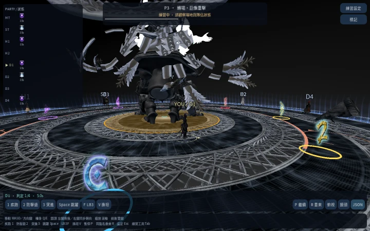

### v0.3.17 開發候選：Cannons 依實際炮標觀察分工

沿用既有炮頭標；動態排序只讀已實際顯示的第一／第二輪三人，固定職責與坦克站位仍可預先採用公開規則。實際 Main 輸入重播 81 流程／468 項 0 失敗（含負向與明示輔助案例），修復後場景 299 項 0 失敗；140個有限物理流程／613項、必要共用與P1事件1266項回歸、獨立來源及輸入覆核亦已通過。v0.3.17 相同匯出包的 20 組檢查與限定 Web 操作已通過；原生 GUI 未通過且桌面操作已停用，因此該候選未發布。該來源改善已由上方 v0.3.18 Web-first 發布承接，原生仍待驗。

[情報、分段輔助與未結門檻](docs/development/CANNONS_OBSERVATION.md)

### v0.3.16 開發候選：Panto 依已顯示提示行動

NPC 不再出生於未來解答點，也不在軸向或旋轉方向顯示前偷跑；掉幀跳過提示時不猜未見方向。82個實際移動流程／757項、Main166項、提示網格127項、原P1事件1266項與必要共用回歸通過。同一 v0.3.16 匯出 PCK 的 17 組檢查及實際 Windows Chrome／AMD WebGL2 輸入與提示畫面已通過；原生 GUI 尚未執行，待實際桌面空檔。原遊戲提示精確時序仍待補證，當時固定站為v0.3.13；不是手動完整通關。

[觀察、玩家責任與驗收邊界](docs/development/PANTO_OBSERVATION.md)

### v0.3.15 開發候選：Sigma 實際手標協作

莫古力 Sigma 依玩家真實手標分工，NPC 不替玩家操作；漏標、錯標與晚改標分開記錄。來源候選的 18 個實際移動重播／1,534 項檢查、170 項 Main 輸入／保存／重試及必要共用回歸通過。新匯出包十三組檢查及Windows Chrome WebGL2實際操作已通過；原生GUI仍待實際桌面空檔，當時固定站為v0.3.13。不是手動完整通關、全部攻略或完整AVFX認證。

[玩家責任、來源與剩餘範圍](docs/development/SIGMA_MANUAL_PREPARATION.md)

### v0.3.14 開發候選：Omega 更多練習族群

獨立莫古力 Omega 加入 II 兩層檢知 0／1／2 人的固定種子練習族群，並修正 JSON 還原的持有人編號。來源的 27 個移動流程／1,403 項合作檢查與必要共用回歸已通過；最終匯出包十組檢查與實際 Web 操作已通過；原生操作仍待桌面空檔，當時固定站為 v0.3.13。這是練習覆蓋，不宣稱完整副本亂數或全部攻略完成。

[範圍、證據與剩餘項目](docs/development/OMEGA_GENERATED_TRAINING.md)

### v0.3.13 歷史已部署階段：Omega 手標驅動協作

歷史階段曾在固定站 [top.servicing.cc](https://top.servicing.cc) 部署 v0.3.13（執行碼 0934b9f）。莫古力 Omega 依實際手標協作，手動／輔助分帳；玩家仍須自己移動、轉面、疾跑及接線。原生 Windows 與 Chrome／AMD GPU 已核對自標、模式套用、同點名重練及兩側檢知來源；固定 HTTPS 資源與全新啟動通過。

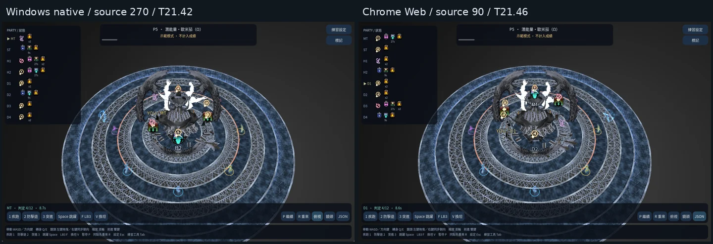

上圖為最終匯出包的實際靜態畫面，分別為 270°／90° 來源；不是影片、手動全流程通關或完整 AVFX 認證。獨立入口的更多 I／II 層數族群、其他攻略分支與全部攻略驗收仍未完成。

[責任、來源與剩餘範圍](docs/development/OMEGA_MANUAL_PREPARATION.md)

### v0.3.12 已部署：Sigma 排隊與可讀塔容量

固定站已部署 v0.3.12（執行碼 783abe2）。Windows 原生與 Chrome／AMD GPU 的五／六塔、提前容量、重開清理及固定網址皆已實際核對。CN 同圖上下橫排，手炮後提前顯示實際塔容量；不改塔判定、擊退、傷害或時間。

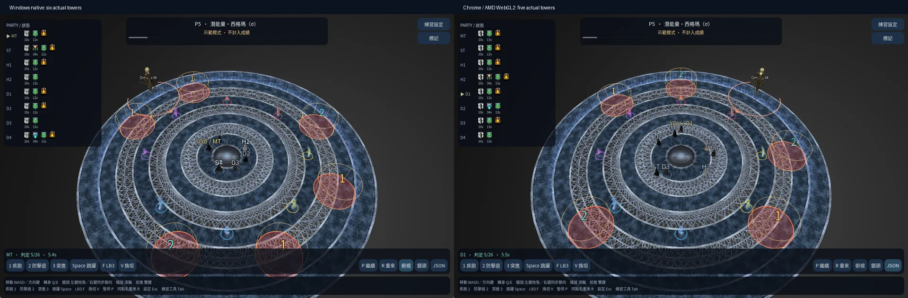

[本階段範圍](docs/development/SIGMA_PREPARATION_INCREMENT.md) · [實際部署紀錄](docs/development/STAGE_DEPLOYMENTS.md)

### v0.3.11：玩家預處理與 NPC 協作增量

固定部署：[top.servicing.cc](https://top.servicing.cc)。已於2026-10-23部署（執行碼 c773d15），包含已覆核的 Delta／P6 修正、HUD 重複工作減少、HW 真實選側與接毒、檢知依攻略優先序排位，以及重試狀態清理。

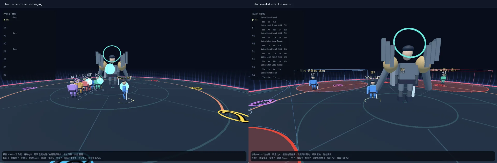

HW 的玩家另一側選擇會讓配對 NPC 補對側並延續本輪接毒；檢知保留原判定時間，玩家仍須自己排位與轉面。這是限定增量，不是全部攻略或完整 AVFX 認證。上圖是 Windows 原生來源版畫面，不冒稱 Web 截圖。

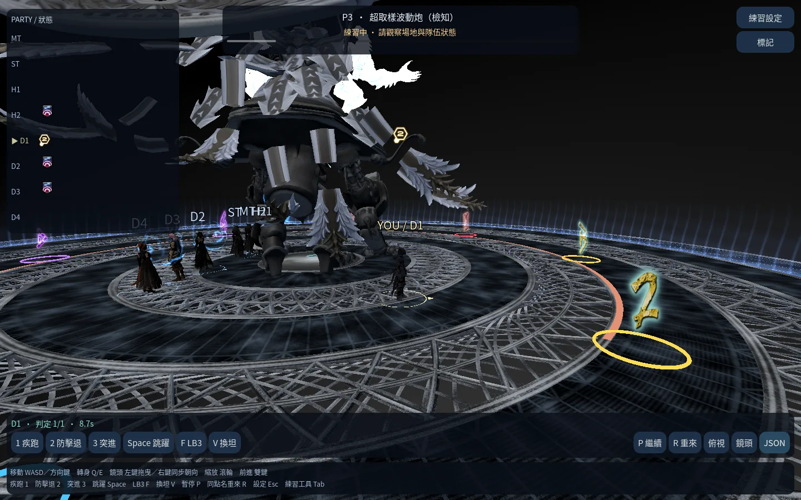

上圖為一般自標、移動、暫停與相機操作驗證；不表示 Sigma／Omega 攻略手標分工已實作。

[本批範圍](docs/development/PLAYER_NPC_PREPARATION_INCREMENT.md) · [完整開發清單](docs/development/TOP_DEVELOPMENT_ROADMAP.md)

先選機制，再選這個機制的攻略方式；每次獨立練習，不自動接續其他機制。預設顯示遊戲場景、八人狀態、必要的 P6 LB 控制及底部操作說明。

## 實際畫面與展示

### v0.3.10：先讀預兆、PT 看武器判斷

宇宙天箭的兩組起始預兆恢復在 T0／T2 顯示；地火四個起點依序出現。Pantokrator 起始火焰、P3／P4 起始波動圓及已鎖定的誘導地板也保留各自預兆時窗，不再被共用的最後 **0.5 秒** 規則誤藏。一般傷害提示與尚未出現的後續推進仍維持最後 0.5 秒；傷害判定、移速及生成條件不變。

PT 的劍／盾、腳刀／法杖由原版 M/F 武器網格供玩家觀察，場上不再附加文字答案；揭示前仍保持中立外觀。攻略說明須主動開啟。目前使用原版模型、resident idle 與武器部件切換，不冒稱完整副本專用動作／AVFX。[預兆分類、時窗及驗證範圍](docs/research/READABLE_CUES.md)。

20 項 Main 完整移動流程與 155 項來源時間檢查通過；P6 有限族群 1,614 項判定／移動檢查、PT 320 組回歸／16,663 項檢查與四種原版武器外觀／260 項檢查皆通過。

最終 PCK 六種機制／十個原生畫面檢查點均接續完成完整流程；正式 Linux 執行檔另經示範入口完成天箭→俯衝 23.2 秒、地火→波動砲 34.4 秒與 PT 34.6 秒，皆 0 失敗。最終 Web PCK 474 項檢查、100 個課程建構通過；Linux／Web／ZIP PCK 一致，固定測試站七個完整資源 SHA256／壓縮／MIME／隔離標頭皆核對通過。這些不等同瀏覽器 GPU 遊玩驗收。


兩張均為最終匯出 PCK 的原生靜態畫面；PT 四格控制武器配置便於對照，不是副本專用動作／AVFX逐幀認證或實體輸入操作影片。

### v0.3.9：逐機制物件生成條件

[20項生成規則核對表](docs/research/SPAWN_RULE_AUDIT.md)：區分固定座標、限定候選槽、相對方向連動與實際玩家誘導，不把攻略站位當敵人出生位置。

- Sigma塔陣僅朝M或M的正對面，不再與M獨立八方亂數。
- LB受保護的女本體回到真北10；場外五分身按已驗證完整配置抽選，避免混出無來源聯合配置。這是四份觀測子集，不宣稱副本只有四種。
- 20項×五攻略×32種子：3,200次生成、39,263條件檢查0失敗；LB20與Sigma40完整移動流程通過。完整伺服器RNG／權重仍未認證。
- 傷害時間／尺寸、移速、0.5秒提示保持不變；仍不宣稱瀏覽器GPU遊玩已驗收。

最終Linux執行檔已由正式示範入口跑完LB38.2秒／5次判定、Sigma58.1秒／26次判定，皆0失敗。最終WebPCK的20項生成、版本、字體與提示設定共40,027檢查0失敗，且與Linux／ZIP PCK雜湊一致；測試站7個完整資源皆通過SHA256／壓縮／隔離標頭核對。


### v0.3.8：PT 辨識提示與逐階段時間軸

PT 補齊兩男兩女、圖案記憶、場外 Optical Unit 與男女交換；火圈、眼睛雷射、擊退、分攤及五男劍擊分開結算。Bot 等到圖案／新北分身實際出現才調整，不再提前使用未公開的點名。

傷害範圍統一只在實際判定前 **0.5 秒** 顯示，含跨段落的連續判定；塔、頭標、連線、場外眼睛及已生效地板仍照機制時序顯示。這是使用者指定的練習提示，不改傷害時間／尺寸或移速，也不宣稱原版都有這種預警。

其他階段一併修正圖像點名與已確認的時間差；檢知改從中央讀點名走位，不直接出生在答案上。20項／100個打法×3固定種子：300完整流程、2397來源時間檢查皆0失敗；320PT＋18檢知實際走位也通過，普通速度仍是6。

[逐項起算點、來源、精度及未驗證範圍](docs/research/PRACTICE_TIMELINES.md) · [PT事件順序](docs/research/P2_SYNERGY_TIMELINE.md)。Optical Unit及頭上圖案為明確標示的重建提示，不冒稱完整原版AVFX／逐幀一致；最終Linux包已完成20項／27個原生畫面檢查及完整PT可執行檔流程；Web測試站完整7資源雜湊與隔離標頭皆通過，不等同瀏覽器遊玩驗收。


[20項最終原生畫面總覽](docs/images/top-v038-stage-overview.webp)。PT六格時點與總覽均來自本次最終匯出PCK的實際畫面；這是靜態檢查點，不是示範影片或瀏覽器驗收。

### v0.3.7：敵人身位環尺寸與面向

v0.3.7 當時測試站已驗證完整檔案與實際匯出PCK；目前站點已更新至上方最新版本。瀏覽器遊玩仍待GPU瀏覽器實測。

按敵人形態套用副本資料中的半徑；不再一律使用4／2.5。原版模型正面、前方箭頭、後方缺口與技能方向採同一座標，亦修正P4面向欄位未被讀取的問題。只校正顯示，不改傷害／碰撞判定。


[來源數值、P2動態半徑範圍與驗證界線](docs/development/ENEMY_RINGS.md)。此版包含下列完整繁中字體修正。

### v0.3.6 測試站：完整繁中字體與正常字重

固定測試網址：[top.servicing.cc](https://top.servicing.cc)。新版 Web 候選改用完整的
**Noto Sans CJK TC Regular 400**，取代只有約1,500字、預設Thin 100的可變字體子集。
選單、HUD、場內3D文字共用內嵌字體；不依賴作業系統安裝字體。現有中日文、標點及旋轉符號皆有字形。
P6底部控制列依字體實際高度向上伸展，不遮住操作說明。


[字體來源、授權與驗證](docs/development/UI_TYPOGRAPHY.md)。此為測試站更新；上方既有下載版本不變。

### v0.3.5：機制名稱語系、新種子與底部操作說明

**[固定網址 Web 測試站](https://top.servicing.cc)**（目前部署版本見頁首更新紀錄；實驗性Web版；未壓縮資源約320.3 MiB；本段已通過 Chrome 操作驗證，完整原版還原仍未完成）。


右上角「機制名稱」可切換繁體中文／English／日本語並記住選擇；清單、預覽標題與練習HUD同步更新。
此開關只改顯示名稱，不切換打法、不重新抽點名，也不重置進度；中文採社群易讀慣稱，不宣稱官方繁中譯名。

- 每次按「開始練習」預設產生不同的新種子；進階設定可關閉此選項並輸入固定種子。
- R／Shift+R與重練目前段落保留既有種子；暫停後「繼續練習」保留原狀態。
- 操作說明固定顯示在設定與練習畫面下方；P6 LB與Tab工具列位於說明上方，不互相遮擋。
- 這是機制名稱語系，不是整套介面／攻略教學的完整翻譯。


[本輪驗證與部署範圍](docs/development/PRACTICE_PREFERENCES.md)

### v0.3.4：簡化選擇流程與固定場地預覽


主畫面只需「選機制 → 選打法／角色 → 開始練習」；右側保留大幅場地預覽。
階段、機制、長打法名稱與 P6 額外控制不再改變預覽尺寸；手動調整的鏡頭也不會因換機制而重設。
種子、點名、速度、分段起點與隊伍／紀錄收進右上角「進階設定／紀錄」；0.3.5起操作說明直接放在底部。
練習後按 Esc 回到設定，再按「繼續練習」保留原狀態；要換機制直接點左側。

此版只提供已驗證的 Linux／source；AnAn 未連線，Windows 未作新版實機驗收。
Web 候選成功匯出，但 VPS 瀏覽器擷取中斷，尚未通過，因此 Windows／Web 仍保留 v0.3.3，不冒稱已更新。
[介面設計與驗證](docs/development/INTERFACE_REDESIGN.md)


### Program Loop：真正的數字狀態與獨立手動標記


- 1～4 是原版 In Line Debuff，不是攻略文字；正確踩塔才消除自己的數字與 Looper。
- 正確處理仍會取得的 Ruin、HP Penalty、易傷、Debugger、Dynamis／Spark，依實際事件呈現，不會因「判定通過」就一律清空。
- **17種玩家目標標記**有獨立的頭頂與隊伍欄位；自己上標不改 Boss／LB 目標，也不打斷 LB 讀條。
- 八個場地標記使用原版字形及 A/1紅、B/2黃、C/3藍、D/4紫配色。可選通用、外圈、不顯示或編輯 JSON 座標；近鏡字形淡出以免遮住人物。
- 可見 death wall 與既有半徑20的死亡邊界對齊，不是阻擋人物進入的實體牆。

### P3 檢知波動砲與身位環


原版左／右充能網格與相關貼圖跟隨實際持有者與面向；光束及命中效果讀取真正判定事件的來源、受擊對象與位置。角色／Boss 腳下的前端箭頭、270°環及後方90°缺口與模型面向同步，不改戰鬥判定半徑。

這段是**實際匯出 WebGL 畫面的俯視、不計分示範錄影**，不是攻略動畫。當前是原版素材重建，**不是完整 AVFX 直接播放器**；attachment、材質與視覺收尾仍有重建部分。[原版來源與精度界線](docs/research/P3_EFFECTS.md)

### 八人 Buff／Debuff


實際受擊、層數、到期、解除及 Brilliant→Spark 轉換都可在隊伍列觀察。原版封包校準與模擬流程測試分開記錄；詳細效果與未完整模擬的狀態見[逐機制狀態表](docs/research/MECHANIC_STATUSES.md)。

## 下載與開始

目前提供 [v0.3.34 Web／精確來源與 SHA256](https://github.com/aki-terminal-leaf/Omega-Protocol-Sim/releases/tag/top-v0.3.34-preview)；固定站提供同版 Web 使用者測試。[v0.3.20 Windows 離線包](https://github.com/aki-terminal-leaf/Omega-Protocol-Sim/releases/tag/top-v0.3.20-preview) 另行保留，原生桌面驗收仍待完成。較早 Linux／Windows 包是歷史版本，不代表含有本版修正；含本機遊戲素材的舊包標記為 `local-game-models`。

- **Windows 原生包（舊版）**：完整解壓，開啟 `TOP-Practice-Lab.exe`，`.pck` 留在旁邊。本版 v0.3.34 請使用下方 Web 步驟。
- **Linux**：`chmod +x TOP-Practice-Lab.x86_64` 後執行。
- **Web v0.3.34**：先安裝 Python 3，完整解壓；Windows 執行 `start-web.cmd`，macOS／Linux 執行 `python3 start-server.py`，再開啟 `http://127.0.0.1:8765/`。隨附伺服器提供必要的 COOP／COEP；不要直接開 `file://`。
- **原始碼**：以 Godot **4.7.2-stable** 開啟 **`top/project.godot`**，不是根目錄的舊 DSR 專案。公開 source ZIP 不含遊戲素材，缺少時使用訓練外觀。

執行發布包不需要遊戲安裝、帳號、ACT、Dalamud、第三方標記器或網路登入。

## 操作

| 操作 | 按鍵 |
| --- | --- |
| 相機相對移動 | WASD／方向鍵 |
| 自由環繞鏡頭 | 按住左鍵拖曳 |
| 旋轉鏡頭並同步人物方向 | 按住右鍵拖曳 |
| 向鏡頭前進 | 同時按住左右鍵，或按住中鍵 |
| 鏡頭距離 | 滾輪 |
| 轉身 | Q／E |
| 跳躍 | Space／L；不提供地面機制免疫 |
| 疾跑／防擊退／突進 | 1／2／3 |
| 暫停／同種子重來 | P／R |
| 不計分示範重播 | Shift+R |
| LB3／挑釁 | F／V |
| 標記面板／對自己上選定標記 | B／M |
| 自己下一空閒攻擊編號／清自標 | N／Backspace |
| 直接對自己上攻擊1～8 | Ctrl+1～8 |
| 練習工具／暫停設定 | Tab／Esc |

在「場地標記」設定修改配置會保留前次紀錄並重開練習；換標不旋轉機制、Boss 或攻略。目標標記會隨同種子重開清空，分段重練則恢復該段入口的實際快照。文字輸入、暫停與檢討不接受上標修改。

「示範」由八名 Bot 操作，不計玩家通關；可另外開教學提示。一般練習及普通暫停不顯示解法／建議落點。失敗後明確開啟工具才顯示參考處理，重試後隱藏。分段開始重建前置狀態，JSON標記 `checkpoint_assisted`。

## 20 項獨立機制與攻略

| 階段 | 機制 |
| --- | --- |
| P1 | Program Loop、Pantokrator、Cannons |
| P2 | Party Synergy、Limitless Synergy |
| P3 | 轉場、Hello World、Monitors |
| P4 | Blue Screen |
| P5 | Delta、Sigma、Omega、Solar Ray，各自獨立 |
| P6 | Cosmo Memory、Arrow→Dive、Exaflare→Wave、Arrow→Wave、Exaflare→Dive、Meteors、Magic Number |

目前102個可選項目包含 Elemental、Aether、LPDU、莫古力及09STOP的已核對約定與變體；**不是20×5套完整區服時間路徑**，也不把語言或社群當成全服統一打法。未實作的變體不掛名為完整解法。[各機制來源與差異](docs/research/STRATEGIES.md)

Program Loop／Limitless／Omega 透過實際移動交接線，Delta成對線在移動中斷開；Hello World有真正的接觸感染、覆蓋、Debugger、Latent與到期事件。建議落點不代替判定，Dynamis依真正受擊產生。

## 驗證與精度範圍

[2026-10-23 NPC／莫古力攻略逐項核對](docs/research/NPC_GUIDE_AUDIT.md)：覆蓋20機制與55項回報。**尚未全部符合攻略**；玩家長線接取及結果顯示的修正，與其餘未完成的站位／時序／手標工作分開列出。

既有100選項階段曾完成實際UI狀態覆蓋及300組完整Main流程回歸；這是歷史範圍，不代表目前102選項已全部完成攻略驗收。各新版的來源、匯出平台與畫面驗證範圍分別記錄於上方版本說明。[驗證紀錄](docs/VALIDATION.md)

仍未宣稱完整原版逐幀／全區服還原：完整AVFX播放、所有原始生成族群、接觸／同時事件的伺服器規則、部分精確時程、完整HP／職業減傷／復活／自然LB量表，以及部分區服路線仍有未校準項目。場地特殊shader／霧效也不是原引擎完整重現。[逐項FIDELITY](docs/research/FIDELITY.md)

手動標記基礎可使用；逐攻略的完整Bot上標規則／多模式仍是後續工作，不以靜態標記顯示冒稱已完成。[標記實作範圍](docs/development/MARKERS_PLAN.md)

## 開發

[全攻略互動 → 最佳化 → 完整AVFX開發路線圖](docs/development/TOP_DEVELOPMENT_ROADMAP.md) · [20機制／102選項玩家預處理與NPC驗收清冊](docs/research/STRATEGY_CONFORMANCE_MATRIX.md)。這是待開發／待驗證計畫，不是全攻略或AVFX已完成的聲明。

```sh
godot --headless --path top --editor --import --quit
godot --headless --path top --script tests/practice_preferences.gd
godot --headless --path top --script tests/runtime.gd
godot --headless --path top --script tests/status_lifecycle.gd
godot --headless --path top --script tests/status_coverage.gd
godot --headless --path top --script tests/markers.gd
godot --headless --path top --script tests/facing_ring.gd
godot --headless --path top --script tests/p3_effects.gd
python3 tools/package.py --godot godot
```

建置需要完全同版的4.7.2官方export templates；非執行緒Web需 `web_nothreads_debug.zip`／`web_nothreads_release.zip`。Godot與隨附GDScript一起鎖版，不使用未驗證的nightly API。[引擎升級](docs/development/GODOT_UPGRADE_PLAN.md) · [分段提交／執行監督](docs/development/SUPERVISION.md)

## 授權與歷史

保留上游[LICENSE](LICENSE)及各檔聲明；舊README見[README.upstream.md](README.upstream.md)。上游部分程式有GPL標頭，未移除或重新授權；新增TOP程式為MIT；Noto字體為SIL OFL，DejaVu符號後備字體保留Bitstream Vera／DejaVu授權。可選遊戲素材不屬於MIT程式碼授權；source ZIP排除遊戲素材，未把整個DSR PCK或攻略影片包入發布。FFXIV名稱屬各權利人；此為非官方工具。

歷史發布：[0.3.2](https://github.com/aki-terminal-leaf/Omega-Protocol-Sim/releases/tag/top-v0.3.2-preview) · [0.3.1](https://github.com/aki-terminal-leaf/Omega-Protocol-Sim/releases/tag/top-v0.3.1-preview) · [0.3.0](https://github.com/aki-terminal-leaf/Omega-Protocol-Sim/releases/tag/top-v0.3.0-preview)
