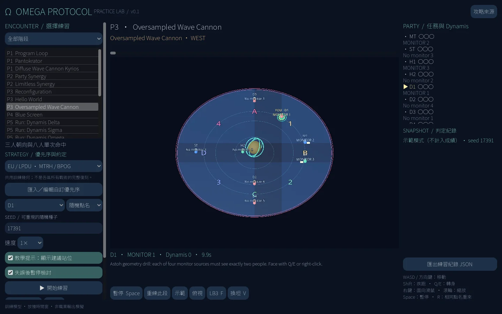

# Omega Protocol — Practice Lab

《FFXIV The Omega Protocol (Ultimate)／絕歐米茄》的 **Godot 4 單人離線走位練習原型**，fork 自 [WCGH/Dragonsong-Sim](https://github.com/WCGH/Dragonsong-Sim)。

**v0.1.0：P1–P6 共 22 個分段練習，1 名玩家 + 7 名 Bot。** 包含可重現種子、指定初始分配、教學／無站位提示、轉身檢知、段落重練、近遠世界實際距離跳躍、Dynamis 連續計數、角色限定 LB 與 JSON 練習紀錄。

> 這是可玩的**示意型練習原型**，不是原戰鬥逐幀重現，也**不是已完整實作所有區服打法**。時間窗放慢、範圍與部分複合機制有簡化。請先看 [精確度與限制](docs/research/FIDELITY.md)。



## 下載與啟動

到 [Releases](https://github.com/aki-terminal-leaf/Omega-Protocol-Sim/releases) 下載對應平台，**完整解壓**後執行：

- Windows x86_64：`TOP-Practice-Lab.exe`（`.pck` 必須留在旁邊）。
- Linux x86_64：`./TOP-Practice-Lab.x86_64`（必要時 `chmod +x`）。
- Web：下載 Web zip，在解壓目錄執行 `python3 -m http.server 8000`，開啟 `http://localhost:8000`。不能用 `file://` 直接開；需要支援 WebGL 2 的桌面瀏覽器。

沒有遊戲安裝、登入、ACT、Dalamud、網路連線或第三方自動標記器依賴。無官方模型、貼圖與音樂。

## 從原始碼執行

**請匯入 `top/project.godot`，不是根目錄的 DSR 專案。** 建議 Godot **4.4.1**，Compatibility renderer。

```sh
godot --path top
```

原倉庫及其授權聲明保留；原 README 在 [README.upstream.md](README.upstream.md)。新專案獨立置於 `top/`，不會載入上游缺失的 `assets/`。

## 操作

1. 選階段、機制、優先序預設、扮演角色及種子，按「開始練習」。
2. WASD／方向鍵移動；Shift 疾跑；Q/E 轉身；右鍵面向滑鼠；滾輪縮放。
3. Space 暫停；R 相同種子重來；F 使用自己角色的 LB3；V 坦克挑釁。
4. 關閉「教學提示」可隱藏建議落點。失誤後可暫停、檢視原因、重練該段或換新點名。
5. 「示範」由八名 Bot 操作，**不算玩家通關**；紀錄會標記 demo。
6. 「指定分配 1–8」固定玩家在洗牌陣列中的初始位置，各機制對應不同任務，**不是頭頂數字 1–8**。Omega 的檢知人選仍須符合 Dynamis／世界順序。
7. 分段開始會從已驗證的示範路徑重建前置 Dynamis／LB 狀態，不把前段跳過當成零層開始。

## 22 個練習

| 階段 | 練習 |
| --- | --- |
| P1 | Program Loop；Pantokrator；Diffuse Wave Cannon Kyrios + proteans |
| P2 | Party Synergy；Limitless Synergy |
| P3 | Reconfiguration transition；Hello World 四輪；Oversampled Wave Cannon |
| P4 | 三輪散開 → 回波 → 分攤 / Blue Screen |
| P5 | Delta；Sigma；Omega；四次 World 的 Dynamis 連續課程；完整三運接續課程；Solar Ray |
| P6 | Cosmo Memory；Arrow→Dive；Exaflare→Wave；Arrow→Wave；Exaflare→Dive；Meteors；Magic Number |

## 戰術研究

可選 **Elemental / Aether / LPDU / CN 莫古力 / KR 09STOP** 的已核對優先序與約定；也可貼入自訂 JSON。這些是**部分約定的預設**，不是五套完整戰術的忠實重現。

- JP / Elemental：HTDH、1234/4231、south flex、P6 east stack。
- NA / Aether：TMR light-party flex、NW/CCW vs N/CW、BPOG/GPOB、north flex。
- EU / LPDU：MTRH、BPOG full-cross；其他部分採共用訓練幾何。
- KR / 09STOP：公開 workbook 文字已核對 P1 全程與 P3 檢知優先序、Sigma 塔宏、Omega 選人；提供**優先序**預設，不是完整韓服戰術。
- CN / 莫古力：公開宏已在正常瀏覽器核對全程 H1→MT→ST→D1→D2→D3→D4→H2；提供**優先序**預設，其餘約定採訓練設定。另確認莫靈喵、MM+W 等來源，未冒稱完整實作。
- TW／其他 DC：不能將「繁體中文攻略」等同「台服統一打法」。未有來源的區服／社群標成未知。

[研究與區服矩陣](docs/research/STRATEGIES.md) · [可機讀來源](docs/research/sources.json) · [精確度／未完成事項](docs/research/FIDELITY.md)

## 架構

沿用上游的職責分工概念，程式重新實作而不依賴舊素材：

```text
top/
  scenes/main.tscn             畫面入口
  scripts/encounters.gd        種子分配 → 分段時間軸 → Bot 站位
  scripts/rules.gd             獨立的幾何、塔、分攤、跳躍、LB 判定
  scripts/arena.gd             程序化 3D 場地、角色與 AoE
  scripts/main.gd              玩家輸入、Bot、暫停／重練／存檔
  data/                       機制目錄、約定預設、來源
  tests/                      快照／反向／完整操作流程測試
```

上游用 `.tscn` 的 AnimationPlayer 呼叫 `.gd`。TOP 原型則使用資料化 beat 佇列，仍由時間軸驅動控制器；**沒有宣稱直接復用了上游場景／程式**。判定不讀建議站位，而是從當下八人位置／朝向重新計算。

## 驗證與建置

```sh
godot --headless --path top --editor --import --quit
godot --headless --path top --script tests/rules.gd
godot --headless --path top --script tests/run.gd
godot --headless --path top --script tests/runtime.gd
python3 tools/package.py --godot godot
```

建置需安裝 Godot 4.4.1 的官方 export templates。[CI 範本](docs/ci/top.yml) 可測試並輸出 Windows／Linux／Web artifacts；目前 GitHub OAuth 不含 workflow scope，未啟用該 workflow。**Windows 匯出成功不代表已在 Windows 實機驗證**。

## 授權

保留上游 `LICENSE`（MIT）及原檔各自聲明；上游部分腳本另有 GPL 標頭，未移除也未重新授權。新增 `top/` 和 `tools/` 程式為 MIT；Noto Sans TC 字型為 SIL OFL，見 `top/fonts/OFL.txt`。攻略來源只作引用與研究，不附帶複製其影片／圖像。FFXIV 及相關名稱屬各權利人；本專案為非官方練習工具。
