# Omega Protocol — Practice Lab

《FFXIV The Omega Protocol (Ultimate)／絕歐米茄》的 Godot **4.7.2-stable** 單人機制練習工具，fork 自 [WCGH/Dragonsong-Sim](https://github.com/WCGH/Dragonsong-Sim)。

**[新版 v0.3.10-preview（Linux／source）](https://github.com/aki-terminal-leaf/Omega-Protocol-Sim/releases/tag/top-v0.3.10-preview)** · [Windows／Web 下載 v0.3.3-preview](https://github.com/aki-terminal-leaf/Omega-Protocol-Sim/releases/tag/top-v0.3.3-preview) · [逐機制 Buff／Debuff](docs/research/MECHANIC_STATUSES.md) · [攻略來源](docs/research/STRATEGIES.md)

先選機制，再選這個機制的攻略方式；每次獨立練習，不自動接續其他機制。預設顯示遊戲場景、八人狀態、必要的 P6 LB 控制及底部操作說明。

## 實際畫面與展示

### v0.3.10：先讀預兆、PT 看武器判斷

宇宙天箭的兩組起始預兆恢復在 T0／T2 顯示；地火四個起點依序出現。Pantokrator 起始火焰、P3／P4 起始波動圓及已鎖定的誘導地板也保留各自預兆時窗，不再被共用的最後 **0.5 秒** 規則誤藏。一般傷害提示與尚未出現的後續推進仍維持最後 0.5 秒；傷害判定、移速及生成條件不變。

PT 的劍／盾、腳刀／法杖由原版 M/F 武器網格供玩家觀察，場上不再附加文字答案；揭示前仍保持中立外觀。攻略說明須主動開啟。目前使用原版模型、resident idle 與武器部件切換，不冒稱完整副本專用動作／AVFX。[預兆分類、時窗及驗證範圍](docs/research/READABLE_CUES.md)。

20 項 Main 完整移動流程與 155 項來源時間檢查通過；P6 有限族群 1,614 項判定／移動檢查、PT 320 組回歸／16,663 項檢查與四種原版武器外觀／260 項檢查皆通過。

最終 PCK 六種機制／十個原生畫面檢查點均接續完成完整流程；正式 Linux 執行檔另經示範入口完成天箭→俯衝 23.2 秒、地火→波動砲 34.4 秒與 PT 34.6 秒，皆 0 失敗。最終 Web PCK 474 項檢查、100 個課程建構通過；Linux／Web／ZIP PCK 一致，固定測試站七個完整資源 SHA256／壓縮／MIME／隔離標頭皆核對通過。這些不等同瀏覽器 GPU 遊玩驗收。

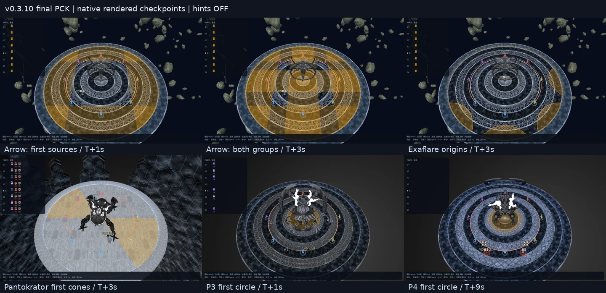

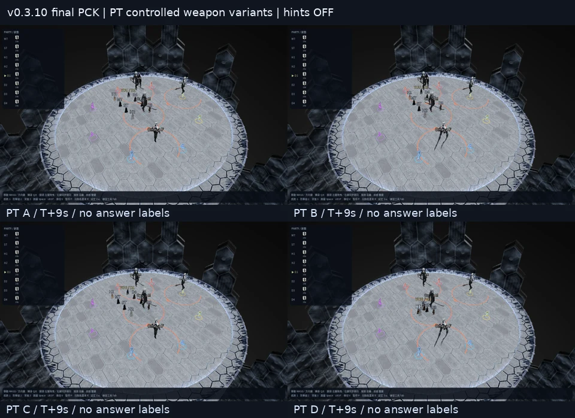

兩張均為最終匯出 PCK 的原生靜態畫面；PT 四格控制武器配置便於對照，不是副本專用動作／AVFX逐幀認證或實體輸入操作影片。

### v0.3.9：逐機制物件生成條件

[20項生成規則核對表](docs/research/SPAWN_RULE_AUDIT.md)：區分固定座標、限定候選槽、相對方向連動與實際玩家誘導，不把攻略站位當敵人出生位置。

- Sigma塔陣僅朝M或M的正對面，不再與M獨立八方亂數。
- LB受保護的女本體回到真北10；場外五分身按已驗證完整配置抽選，避免混出無來源聯合配置。這是四份觀測子集，不宣稱副本只有四種。
- 20項×五攻略×32種子：3,200次生成、39,263條件檢查0失敗；LB20與Sigma40完整移動流程通過。完整伺服器RNG／權重仍未認證。
- 傷害時間／尺寸、移速、0.5秒提示保持不變；仍不宣稱瀏覽器GPU遊玩已驗收。

最終Linux執行檔已由正式示範入口跑完LB38.2秒／5次判定、Sigma58.1秒／26次判定，皆0失敗。最終WebPCK的20項生成、版本、字體與提示設定共40,027檢查0失敗，且與Linux／ZIP PCK雜湊一致；測試站7個完整資源皆通過SHA256／壓縮／隔離標頭核對。

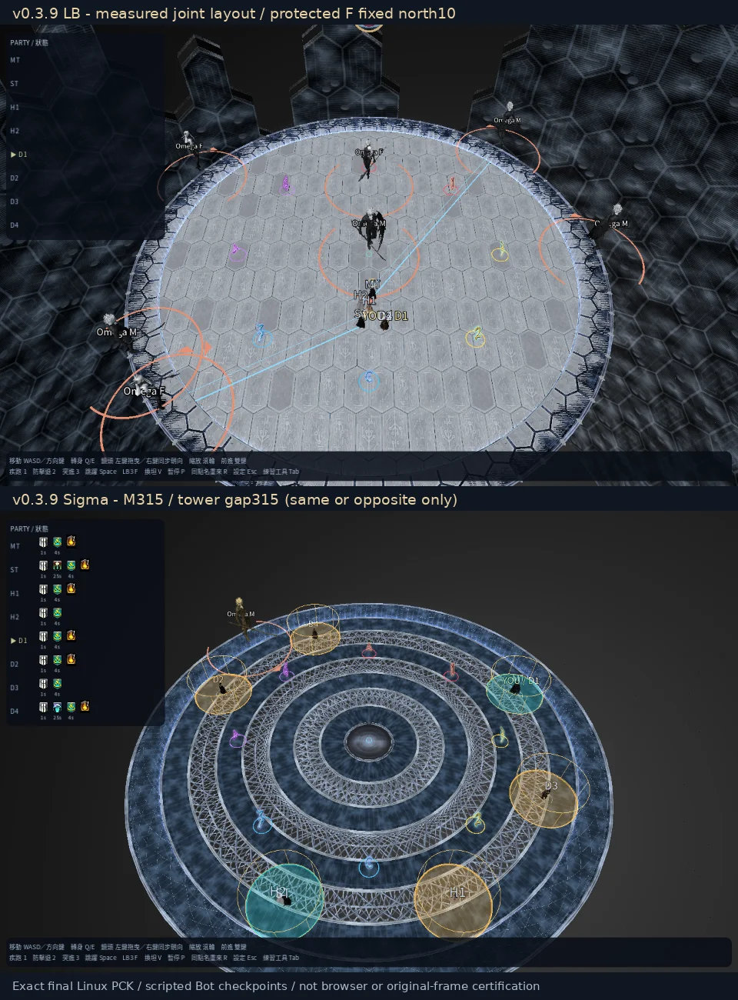

### v0.3.8：PT 辨識提示與逐階段時間軸

PT 補齊兩男兩女、圖案記憶、場外 Optical Unit 與男女交換；火圈、眼睛雷射、擊退、分攤及五男劍擊分開結算。Bot 等到圖案／新北分身實際出現才調整，不再提前使用未公開的點名。

傷害範圍統一只在實際判定前 **0.5 秒** 顯示，含跨段落的連續判定；塔、頭標、連線、場外眼睛及已生效地板仍照機制時序顯示。這是使用者指定的練習提示，不改傷害時間／尺寸或移速，也不宣稱原版都有這種預警。

其他階段一併修正圖像點名與已確認的時間差；檢知改從中央讀點名走位，不直接出生在答案上。20項／100個打法×3固定種子：300完整流程、2397來源時間檢查皆0失敗；320PT＋18檢知實際走位也通過，普通速度仍是6。

[逐項起算點、來源、精度及未驗證範圍](docs/research/PRACTICE_TIMELINES.md) · [PT事件順序](docs/research/P2_SYNERGY_TIMELINE.md)。Optical Unit及頭上圖案為明確標示的重建提示，不冒稱完整原版AVFX／逐幀一致；最終Linux包已完成20項／27個原生畫面檢查及完整PT可執行檔流程；Web測試站完整7資源雜湊與隔離標頭皆通過，不等同瀏覽器遊玩驗收。

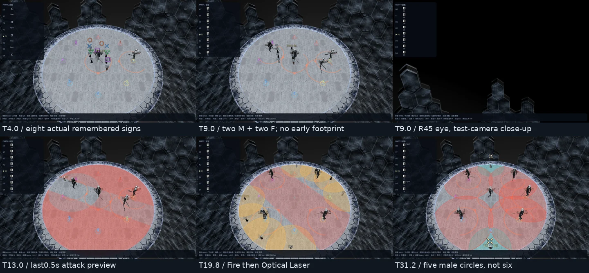

[20項最終原生畫面總覽](docs/images/top-v038-stage-overview.webp)。PT六格時點與總覽均來自本次最終匯出PCK的實際畫面；這是靜態檢查點，不是示範影片或瀏覽器驗收。

### v0.3.7：敵人身位環尺寸與面向

v0.3.7 當時測試站已驗證完整檔案與實際匯出PCK；目前站點已更新至上方最新版本。瀏覽器遊玩仍待GPU瀏覽器實測。

按敵人形態套用副本資料中的半徑；不再一律使用4／2.5。原版模型正面、前方箭頭、後方缺口與技能方向採同一座標，亦修正P4面向欄位未被讀取的問題。只校正顯示，不改傷害／碰撞判定。

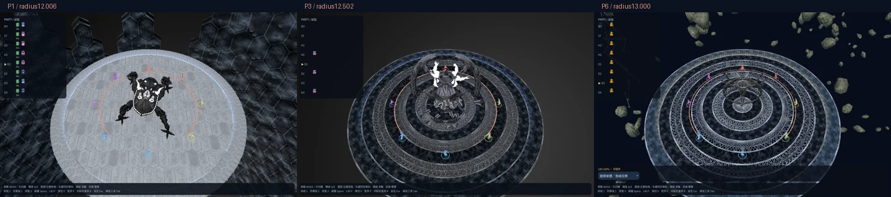

[來源數值、P2動態半徑範圍與驗證界線](docs/development/ENEMY_RINGS.md)。此版包含下列完整繁中字體修正。

### v0.3.6 測試站：完整繁中字體與正常字重

固定測試網址：[top.servicing.cc](https://top.servicing.cc)。新版 Web 候選改用完整的
**Noto Sans CJK TC Regular 400**，取代只有約1,500字、預設Thin 100的可變字體子集。
選單、HUD、場內3D文字共用內嵌字體；不依賴作業系統安裝字體。現有中日文、標點及旋轉符號皆有字形。
P6底部控制列依字體實際高度向上伸展，不遮住操作說明。

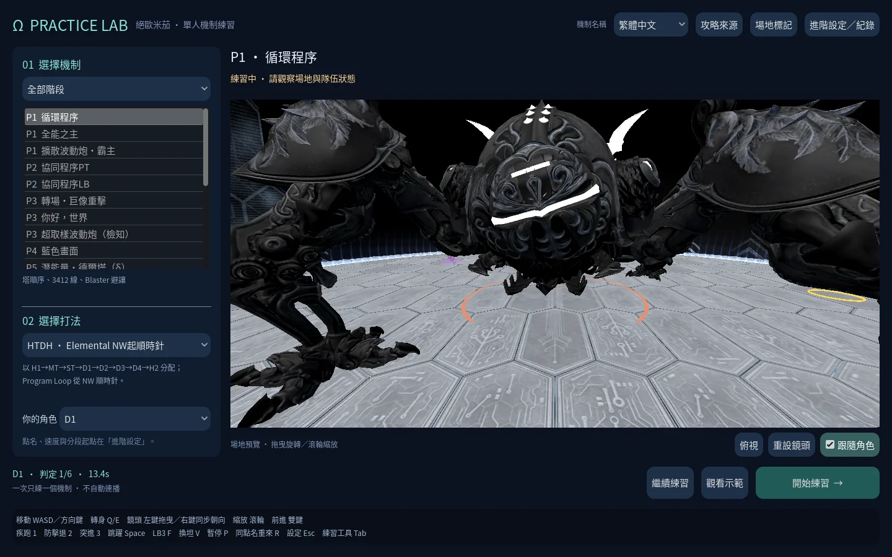

[字體來源、授權與驗證](docs/development/UI_TYPOGRAPHY.md)。此為測試站更新；上方既有下載版本不變。

### v0.3.5：機制名稱語系、新種子與底部操作說明

**[固定網址 Web 測試站](https://top.servicing.cc)**（目前為v0.3.10實驗性Web版；首次下載約217.3 MiB，尚未完成桌面瀏覽器遊玩驗收）。

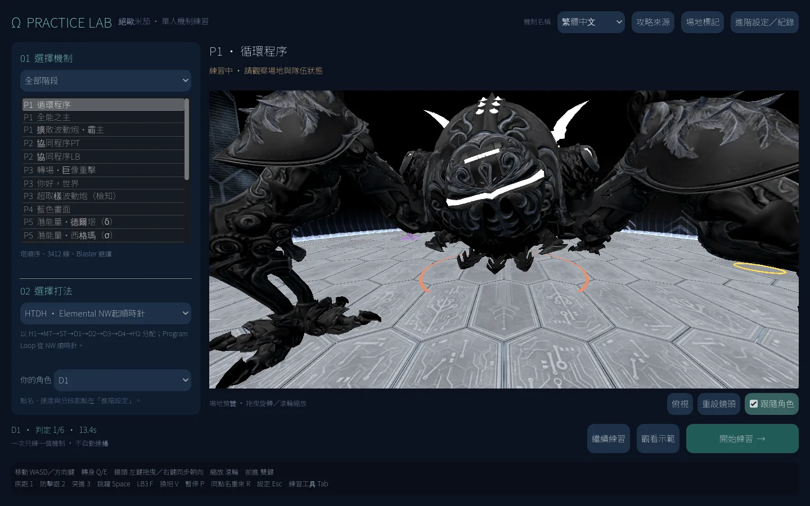

右上角「機制名稱」可切換繁體中文／English／日本語並記住選擇；清單、預覽標題與練習HUD同步更新。
此開關只改顯示名稱，不切換打法、不重新抽點名，也不重置進度；中文採社群易讀慣稱，不宣稱官方繁中譯名。

- 每次按「開始練習」預設產生不同的新種子；進階設定可關閉此選項並輸入固定種子。
- R／Shift+R與重練目前段落保留既有種子；暫停後「繼續練習」保留原狀態。
- 操作說明固定顯示在設定與練習畫面下方；P6 LB與Tab工具列位於說明上方，不互相遮擋。
- 這是機制名稱語系，不是整套介面／攻略教學的完整翻譯。

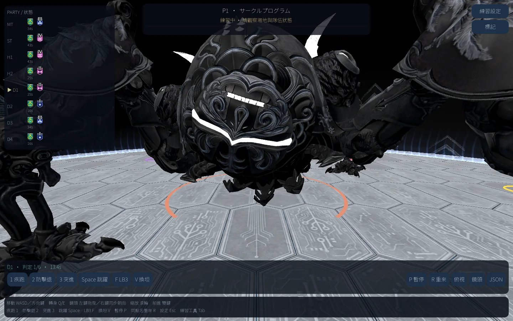

[本輪驗證與部署範圍](docs/development/PRACTICE_PREFERENCES.md)

### v0.3.4：簡化選擇流程與固定場地預覽

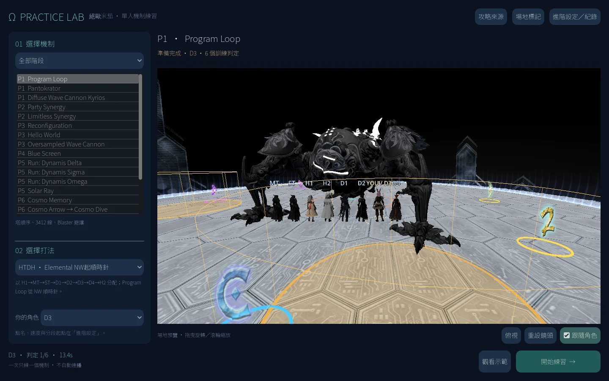

主畫面只需「選機制 → 選打法／角色 → 開始練習」；右側保留大幅場地預覽。
階段、機制、長打法名稱與 P6 額外控制不再改變預覽尺寸；手動調整的鏡頭也不會因換機制而重設。
種子、點名、速度、分段起點與隊伍／紀錄收進右上角「進階設定／紀錄」；0.3.5起操作說明直接放在底部。
練習後按 Esc 回到設定，再按「繼續練習」保留原狀態；要換機制直接點左側。

此版只提供已驗證的 Linux／source；AnAn 未連線，Windows 未作新版實機驗收。
Web 候選成功匯出，但 VPS 瀏覽器擷取中斷，尚未通過，因此 Windows／Web 仍保留 v0.3.3，不冒稱已更新。
[介面設計與驗證](docs/development/INTERFACE_REDESIGN.md)


### Program Loop：真正的數字狀態與獨立手動標記

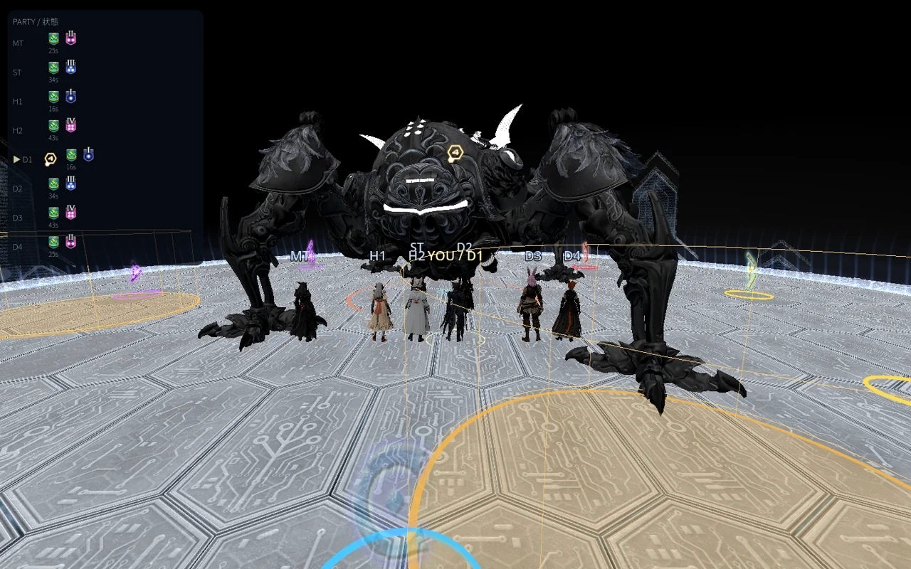

- 1～4 是原版 In Line Debuff，不是攻略文字；正確踩塔才消除自己的數字與 Looper。
- 正確處理仍會取得的 Ruin、HP Penalty、易傷、Debugger、Dynamis／Spark，依實際事件呈現，不會因「判定通過」就一律清空。
- **17種玩家目標標記**有獨立的頭頂與隊伍欄位；自己上標不改 Boss／LB 目標，也不打斷 LB 讀條。
- 八個場地標記使用原版字形及 A/1紅、B/2黃、C/3藍、D/4紫配色。可選通用、外圈、不顯示或編輯 JSON 座標；近鏡字形淡出以免遮住人物。
- 可見 death wall 與既有半徑20的死亡邊界對齊，不是阻擋人物進入的實體牆。

### P3 檢知波動砲與身位環

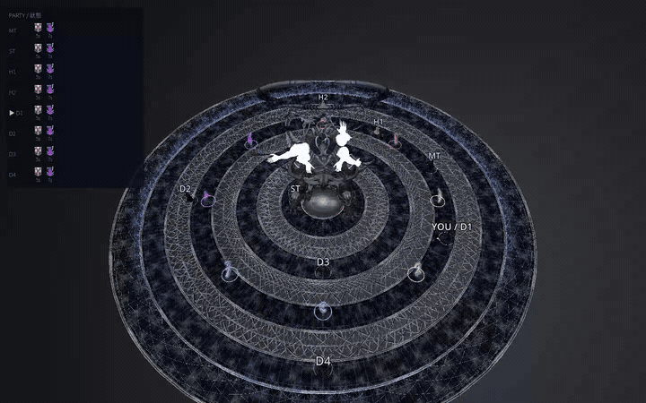

原版左／右充能網格與相關貼圖跟隨實際持有者與面向；光束及命中效果讀取真正判定事件的來源、受擊對象與位置。角色／Boss 腳下的前端箭頭、270°環及後方90°缺口與模型面向同步，不改戰鬥判定半徑。

這段是**實際匯出 WebGL 畫面的俯視、不計分示範錄影**，不是攻略動畫。當前是原版素材重建，**不是完整 AVFX 直接播放器**；attachment、材質與視覺收尾仍有重建部分。[原版來源與精度界線](docs/research/P3_EFFECTS.md)

### 八人 Buff／Debuff

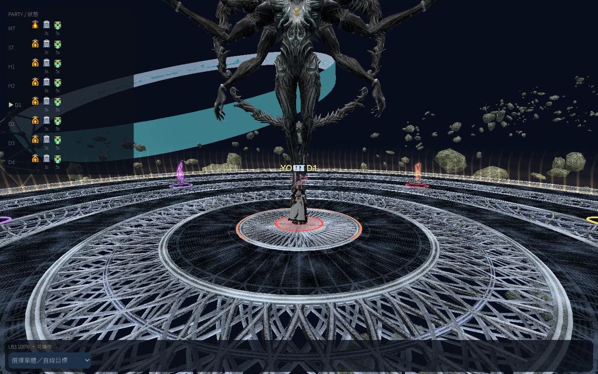

實際受擊、層數、到期、解除及 Brilliant→Spark 轉換都可在隊伍列觀察。原版封包校準與模擬流程測試分開記錄；詳細效果與未完整模擬的狀態見[逐機制狀態表](docs/research/MECHANIC_STATUSES.md)。

## 下載與開始

v0.3.8 預覽提供已驗證的 Linux、source ZIP 與 SHA256 校驗碼；固定網址提供新版 Web 使用者測試，v0.3.3 發布頁仍保留已驗證的舊 Windows／Web 下載。含本機遊戲素材的包標記為 `local-game-models`。既有0.3.2／0.3.1／0.3.0下載保持不變。

- **Windows**：完整解壓，開啟 `TOP-Practice-Lab.exe`，`.pck` 留在旁邊。
- **Linux**：`chmod +x TOP-Practice-Lab.x86_64` 後執行。
- **Web**：在解壓資料夾執行 `python3 -m http.server 8000`，開啟 `http://localhost:8000`；不要直接開 `file://`。
- **原始碼**：以 Godot **4.7.2-stable** 開啟 **`top/project.godot`**，不是根目錄的舊 DSR 專案。公開 source ZIP 不含遊戲素材，缺少時使用訓練外觀。

執行發布包不需要遊戲安裝、帳號、ACT、Dalamud、第三方標記器或網路登入。

## 操作

| 操作 | 按鍵 |
| --- | --- |
| 相機相對移動 | WASD／方向鍵 |
| 自由環繞鏡頭 | 按住左鍵拖曳 |
| 旋轉鏡頭並同步人物方向 | 按住右鍵拖曳 |
| 向鏡頭前進 | 同時按住左右鍵，或按住中鍵 |
| 鏡頭距離 | 滾輪 |
| 轉身 | Q／E |
| 跳躍 | Space／L；不提供地面機制免疫 |
| 疾跑／防擊退／突進 | 1／2／3 |
| 暫停／同種子重來 | P／R |
| 不計分示範重播 | Shift+R |
| LB3／挑釁 | F／V |
| 標記面板／對自己上選定標記 | B／M |
| 自己下一空閒攻擊編號／清自標 | N／Backspace |
| 直接對自己上攻擊1～8 | Ctrl+1～8 |
| 練習工具／暫停設定 | Tab／Esc |

在「場地標記」設定修改配置會保留前次紀錄並重開練習；換標不旋轉機制、Boss 或攻略。目標標記會隨同種子重開清空，分段重練則恢復該段入口的實際快照。文字輸入、暫停與檢討不接受上標修改。

「示範」由八名 Bot 操作，不計玩家通關；可另外開教學提示。一般練習及普通暫停不顯示解法／建議落點。失敗後明確開啟工具才顯示參考處理，重試後隱藏。分段開始重建前置狀態，JSON標記 `checkpoint_assisted`。

## 20 項獨立機制與攻略

| 階段 | 機制 |
| --- | --- |
| P1 | Program Loop、Pantokrator、Cannons |
| P2 | Party Synergy、Limitless Synergy |
| P3 | 轉場、Hello World、Monitors |
| P4 | Blue Screen |
| P5 | Delta、Sigma、Omega、Solar Ray，各自獨立 |
| P6 | Cosmo Memory、Arrow→Dive、Exaflare→Wave、Arrow→Wave、Exaflare→Dive、Meteors、Magic Number |

目前100個可選項目包含 Elemental、Aether、LPDU、莫古力及09STOP的已核對約定與變體；**不是20×5套完整區服時間路徑**，也不把語言或社群當成全服統一打法。未實作的變體不掛名為完整解法。[各機制來源與差異](docs/research/STRATEGIES.md)

Program Loop／Limitless／Omega 透過實際移動交接線，Delta成對線在移動中斷開；Hello World有真正的接觸感染、覆蓋、Debugger、Latent與到期事件。建議落點不代替判定，Dynamis依真正受擊產生。

## 驗證與精度範圍

[2026-10-23 NPC／莫古力攻略逐項核對](docs/research/NPC_GUIDE_AUDIT.md)：覆蓋20機制與55項回報。**尚未全部符合攻略**；玩家長線接取及結果顯示的修正，與其餘未完成的站位／時序／手標工作分開列出。

本輪完成100個現有選項的實際UI狀態覆蓋及300組完整Main流程回歸；另有原始封包對照、實際匯出平台與畫面驗收。[驗證紀錄](docs/VALIDATION.md)

仍未宣稱完整原版逐幀／全區服還原：完整AVFX播放、所有原始生成族群、接觸／同時事件的伺服器規則、部分精確時程、完整HP／職業減傷／復活／自然LB量表，以及部分區服路線仍有未校準項目。場地特殊shader／霧效也不是原引擎完整重現。[逐項FIDELITY](docs/research/FIDELITY.md)

手動標記基礎可使用；逐攻略的完整Bot上標規則／多模式仍是後續工作，不以靜態標記顯示冒稱已完成。[標記實作範圍](docs/development/MARKERS_PLAN.md)

## 開發

[全攻略互動 → 最佳化 → 完整AVFX開發路線圖](docs/development/TOP_DEVELOPMENT_ROADMAP.md) · [20機制／100選項玩家預處理與NPC驗收清冊](docs/research/STRATEGY_CONFORMANCE_MATRIX.md)。這是待開發／待驗證計畫，不是全攻略或AVFX已完成的聲明。

```sh
godot --headless --path top --editor --import --quit
godot --headless --path top --script tests/practice_preferences.gd
godot --headless --path top --script tests/runtime.gd
godot --headless --path top --script tests/status_lifecycle.gd
godot --headless --path top --script tests/status_coverage.gd
godot --headless --path top --script tests/markers.gd
godot --headless --path top --script tests/facing_ring.gd
godot --headless --path top --script tests/p3_effects.gd
python3 tools/package.py --godot godot
```

建置需要完全同版的4.7.2官方export templates；非執行緒Web需 `web_nothreads_debug.zip`／`web_nothreads_release.zip`。Godot與隨附GDScript一起鎖版，不使用未驗證的nightly API。[引擎升級](docs/development/GODOT_UPGRADE_PLAN.md) · [分段提交／執行監督](docs/development/SUPERVISION.md)

## 授權與歷史

保留上游[LICENSE](LICENSE)及各檔聲明；舊README見[README.upstream.md](README.upstream.md)。上游部分程式有GPL標頭，未移除或重新授權；新增TOP程式為MIT；Noto字體為SIL OFL，DejaVu符號後備字體保留Bitstream Vera／DejaVu授權。可選遊戲素材不屬於MIT程式碼授權；source ZIP排除遊戲素材，未把整個DSR PCK或攻略影片包入發布。FFXIV名稱屬各權利人；此為非官方工具。

歷史發布：[0.3.2](https://github.com/aki-terminal-leaf/Omega-Protocol-Sim/releases/tag/top-v0.3.2-preview) · [0.3.1](https://github.com/aki-terminal-leaf/Omega-Protocol-Sim/releases/tag/top-v0.3.1-preview) · [0.3.0](https://github.com/aki-terminal-leaf/Omega-Protocol-Sim/releases/tag/top-v0.3.0-preview)
