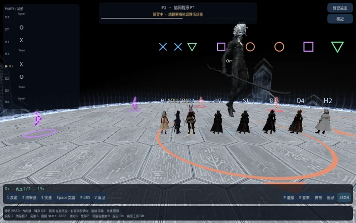

# Aether Party Synergy：實際橫排換序與公開圖形記憶

## 原始來源與練習規則

2026-10-24 讀取 Aether/thepfstrat 所連 [Toolbox 043186470764761](https://ff14.toolboxgaming.space/?id=043186470764761&preview=1#3) 的原始步驟及圖像。Step3/5 的橫排不是強制職能站位：HRMTTMRH 只作推薦起始列，同圖案兩人按實際左右決定組別，不從隱藏真配對生成起始站位。此訓練以 1.8m 間距實作，不把間距或容差視為原遊戲數值。

玩家可用 WASD 在圖形出現前選擇八個橫排名次；七名 NPC 依玩家當下實際位置留位，不讀未揭露點名或按鍵意圖，不移動玩家或暗中救場。合法原地準備仍有效，沒有額外「未排隊」傷害。

完整八人紋理圖形真正顯示後，記住同一畫面的圖案與位置；此首次完整觀察凍結是明示的訓練政策，不是已證實的遊戲鎖定時限。圖形消失後及玩家之後移動不改寫已觀察的左右；重複顯示不得拿即時位置重新分組。無效／矛盾記憶維持 NPC 實際位置，不退回隱藏預算路線；R／新一輪清空舊記憶，跳段模擬仍明示輔助。

Fire 圖案順序 X／Square／O／Triangle；Remote 只交換外側列，不能混用 LPDU 的完全反轉。既有後段 north flex 只做回歸保留；武器／分身躲避仍是舊基線，不算本增量通過。

## 來源驗證（不是 Web／原生驗收）

純分組 2,520 種／30,351 項；單元 64 項；實際 Main 159 項。真實 InputEventKey／Input.parse_input_event 的無桌面 Main 驗證 141 課程／1,825 項：128 種八角色×八名次×Mid/Remote，五個漏做／走錯／太晚／釋放輸入負向案例，八個合法不換位準備。移速 6、不使用衝刺或位移能力，實際 Fire／Glitch 判定與放開輸入不被 NPC 救回皆檢查；不是最後 Bot 座標推定成功。

240 組生成差分相同：其餘四種解法完整序列（含公開 metadata）保持一致；Aether 僅排除刻意更改的公開準備 metadata／路線位置／起始站位。真 RNG、圖形搭檔、目標、傷害幾何與時間保持不變。Elemental／LPDU 原 Main 與各 29 條實際輸入、320 組 P2／16,663 項及 20 機制 Main 必要回歸通過。獨立跨模型唯讀審查和父層核對分別留存；協作 CLI 曾逾時的局部產出未被當成成功。

範圍是 seed17391、eye0／clone22.5 的實際輸入矩陣，不是所有初始順序／全部隨機幾何。武器／新北／後段分攤、CN/KR、完整 P2、全20機制100選項符合性、量測最佳化與完整 AVFX 仍在進行。此來源候選其後已完成下節列出的新 PCK／Web／固定 HTTPS 驗收。原生驗收獨立待驗，Windows v0.3.20 保留自身證據。

## v0.3.23 實際 Web 發布

固定站 https://top.servicing.cc 已驗收更新。執行碼 `7a98670e79b6429ccd8e7b2df009c2c5e270ea82`，相同新PCK `55a96509a8d9b53c338c67f6501d99416b31faab760827677aed3e8f6c2d14ab`。十三組精確PCK與實際Web十項操作、固定HTTPS十三種表示、全新啟動通過。父層實際檢視本輪頭標前／顯示／擷取後玩家再移動／圖形消失／R重開畫面；下載報告驗證實際名次0與同圖案搭檔換側、凍結位置不改寫、放開輸入不被NPC移動。不是完整手動Fire／武器／P2通關；Fire負向與正向仍由同一PCK的141條真實輸入檢查提供。原生獨立待驗。

[發布與下載](https://github.com/aki-terminal-leaf/Omega-Protocol-Sim/releases/tag/top-v0.3.23-preview)。下圖是同次Web擷取圖形後玩家再移動的實際畫面，記憶仍保留原先位置；非原生或全攻略認證。

