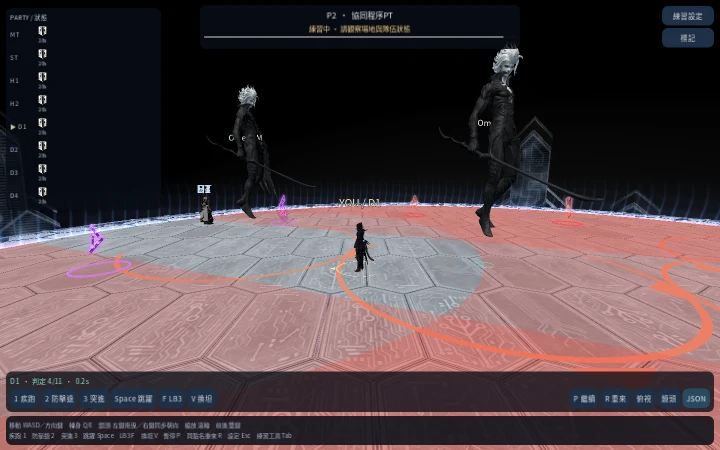

# Party Synergy：公開實體武器提示與 NPC 躲避

## v0.3.24 限定範圍

此增量涵蓋 Elemental、Aether、LPDU、CN、KR 五種 P2 選項的武器躲避路徑，不代表這五種攻略的其他階段全部符合。新 PCK、瀏覽器、固定 HTTPS 與 release 已另完成下節的限定驗收。原生待驗，Windows v0.3.20 保留自身獨立證據。

NPC 先從真正可見、外側互為對面的男／女分身，辨認原模型 A/B 武器部件；無原版資源時，只有可見且具有 Mesh 的替代武器才算提示。不是讀取 stance metadata、標籤、已解答的 beat.positions 或傷害形狀。實際 Main 在可見性與武器切換完成後才發布觀察，粗時間子步進不能假造已顯示的提示。無桌面非呈現測試使用不同、明示未顯示的 basis，不冒充畫面觀察。

沒有提示時 NPC 留在實際位置。有效觀察後提示真正消失／中性可保留過去；之後若同時亮出兩種武器、部件不一致，或資料出現重複／歧義／非有限位置，撤銷記憶並停在當前位置。錯誤可見武器就是錯誤公開輸入，不能拿隱藏傷害幾何救場。新一段／重開清空舊記憶，跳段輔助使用獨立標記。玩家仍只能由自己的輸入移動。

安全點計算只依公開分身位置與武器，重用既有 pair_shapes／格點掃描。單一格點路徑是刻意保留的限定範圍：LPDU Step6 的分組側符合性仍 OPEN；沒有新增反應延遲、傷害規則或來源未證實的遊戲鎖定時限。

## 來源與實際檢查

原始參考：[Aether Toolbox Step6/7](https://ff14.toolboxgaming.space/?id=043186470764761&preview=1#6)、[LPDU Toolbox Step5/6](https://ff14.toolboxgaming.space/?id=502396712985961&preview=1#5)。已實際核對這四張圖及角色座標；這不等於 CN／KR 全流程原始攻略認證。

純 helper 197 項通過（五選項×八角度×四武器組合的160個正向案例）。獨立複核指出的五種過期記憶錯誤先重現為197項／5失敗，修正後197／0；真正消失仍能記住。

實際 Main 原版模型十五課程／187項通過：八個正向覆蓋四武器組合與兩角度，七個負向／生命週期案例涵蓋無提示、雙武器、錯誤武器、玩家走錯、WASD釋放、有效提示後矛盾與有效提示後消失。錯誤武器讓 NPC 實際受傷，玩家在真安全區無傷；走錯的玩家實際受傷而 NPC 無傷。這是 InputEventKey／Input.parse_input_event 的無桌面 Main 驗證，不是原生 OS 輸入、實體 GPU 或真人完整通關。

240組生成差分對五選項完整保留原 RNG、真搭檔、目標、時間、幾何、座標、起始站位及既有公開metadata；只忽略新加入的版本／選項標記。Rules、Statuses、Clone patterns、move_player、resolve_beat 原碼不變。Aether Main159／141條實際輸入1825項、Elemental Main350／29條345項、LPDU Main306／29條345項、P2 320組16663項、二十機制 Main，以及四武器組合原版模型外觀回歸通過。原400秒回歸批次逾時與部分輸出保留，只續跑未完成項目，不計為通過。獨立跨模型唯讀複核最終無待修缺陷，父層另核對原碼與實際結果。

武器之外的新北、後段分攤、LPDU分組側、其他攻略分支、全20機制／100選項符合性、量測最佳化與完整AVFX仍繼續。不是完整P2或全攻略驗收。

## v0.3.24 實際 Web 發布

固定站 https://top.servicing.cc；執行碼 47dec6d7ac38dca13fb446d4c0b0f46df506dad3，相同新PCK 6f9476716f7f1b91c6f6c3fda322640073ff8e965818137b3b96777a2236f7de。十五組精確PCK檢查保留上一版全部十三組，加上197純武器檢查與十五原版模型Main／187項；實際Web八項、HTTPS十三種表示與全新啟動通過。八項Web聚焦本增量，不宣稱重跑上一版十項橫排UI案例。父層實際檢視本輪提示前／武器顯示／玩家釋放輸入／NPC路徑／R重開畫面。

瀏覽器從一般選單自然開始，未跳段、未寫入角色座標；13.4秒判定前停止。錯誤提示的NPC傷害、人類真安全區無傷、矛盾停步／消失保留記憶，屬同一新PCK的十五Main課程證據，不是瀏覽器fault injection／手動完整通關。無桌面SwiftShader不是原生或實體GPU認證。

[發布與下載](https://github.com/aki-terminal-leaf/Omega-Protocol-Sim/releases/tag/top-v0.3.24-preview)。原生24獨立待驗，Windows20未被當成24證據。

